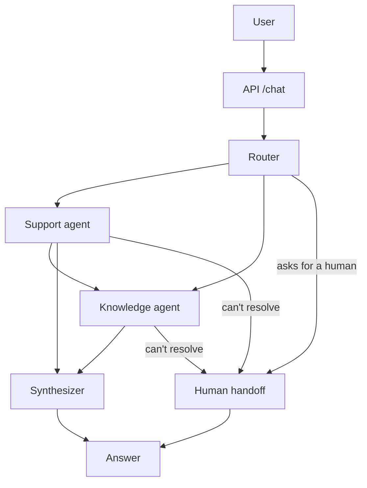

# Getnet multi-agent support

A multi-agent assistant for Getnet customers. A router reads each message and decides who answers: a **knowledge agent** (Getnet website via RAG, or the web) and/or a **support agent** (the customer's own account data). If nobody can solve it, a human takes over through an operator queue. An offline evaluator scores the whole system.

**Stack:** LangGraph, `gpt-oss` models on Groq or Fireworks (`AGENT_PROVIDER`), `qwen3.8-27b` on Groq as the eval judge, Voyage embeddings, Chroma, Tavily, FastAPI, SQLite, Docker.

Demo video: https://youtu.be/bnBYBmf2AlQ

**Docs:** [SPEC](docs/SPEC.md) (requirements and the test or eval case that checks each one) · [Challenge statement](docs/CHALLENGE.md)

## How it works



1. The router picks the agents (`support`, `knowledge`, both, or none) and detects the language. If both are needed, support goes first so knowledge can use what it found.
2. Each agent uses tools. Support reads account data; knowledge searches the Getnet knowledge base (Chroma) or the web (Tavily).
3. The synthesizer builds the final reply: no agent ran → answers directly, one → passes it through, two → merges them.
4. If the user asks for a person, or nobody could resolve the request, the handoff node opens a ticket, queues the case for the operators and tells the user.

The response also lists which agents ran, the tools they called, the sources and the token usage, so it is easy to debug.

**Design choices**

- **Plan first, then run.** One router call, then the agents run in order. Cheaper and more predictable than a supervisor loop, and easy to test.
- **Customer isolation.** The customer is the authenticated JWT `sub`, never something in the body or the prompt. Support tools are created per request, already tied to that customer, and take no user argument, so "show me cliente2024's data" cannot change whose data is read. A test inspects the schema of every tool and fails if one exposes a parameter that selects a user.
- **Retrieval.** Contracts and manuals are ~60% of the chunks and crowded out the useful pages, so search returns 3 web pages + at most 2 PDFs.
- **Fails softly.** If something breaks, the request continues with `degraded: true`; if every agent fails, the case goes to a human. The API does not 500 because of the LLM.
- **Handoff by tool, not by score.** Retrieval scores overlap between answerable (0.41-0.67) and unanswerable (0.37-0.50) questions, so no threshold works. Agents call an explicit `escalate_to_human(reason)` tool instead.
- **Fake customer data** lives behind `app/data/repository.py`; replace that class to use a real backend.

## Run it

```bash
cp .env.example .env            # add GROQ_API_KEY, TAVILY_API_KEY, VOYAGE_API_KEY and a real JWT_SECRET

docker compose build
docker compose run --rm ingest  # builds the knowledge base (slow on Voyage's free tier)
docker compose up -d            # API on http://localhost:8000
```

```bash
# the API needs a JWT (see Authentication). This makes one for the demo customer cliente1988:
TOKEN=$(docker compose exec -T api python -m scripts.issue_token --user cliente1988 | head -1)

curl -s -X POST http://localhost:8000/chat \
  -H "Authorization: Bearer $TOKEN" -H "Content-Type: application/json" \
  -d '{"message": "My card machine won'\''t connect to the internet, what should I do?"}'
```

Without Docker:

```bash
python -m venv .venv && source .venv/bin/activate     # Windows: .venv\Scripts\activate
pip install -r requirements-dev.txt
python -m app.rag.ingest
uvicorn app.main:app --reload
python -m scripts.issue_token --user cliente1988     # prints a token and an example curl
```

`python -m app.rag.ingest --from-cache` re-indexes without spending Tavily credits. `GET /health` shows how many chunks are in the knowledge base.

**Demo customers** (fake data):

| Token `sub` | What's going on |
|---|---|
| `cliente1988` | Terminal offline (weak Wi-Fi), pending payouts, two declined sales |
| `cliente2024` | Healthy account, Pix on |
| `cliente3030` | Printer out of paper, one open ticket, Pix off |

### Configuration

Everything comes from `.env` (see [.env.example](.env.example), every variable is commented). `docker-compose.yml` passes the model variables to the containers.

| Variable | Role | Default |
|---|---|---|
| `AGENT_PROVIDER` | Provider of every agent: `groq` (`GROQ_API_KEY`) or `fireworks` (OpenAI-compatible API, `FIREWORKS_API_KEY`). The judge is always Groq | `groq` |
| `LLM_MODEL` | Knowledge agent | `openai/gpt-oss-120b` |
| `LIGHT_MODEL` | Router, synthesizer, rolling summary | `openai/gpt-oss-20b` |
| `SUPPORT_MODEL` | Support agent | empty = same as `LIGHT_MODEL` (`.env.example` sets `openai/gpt-oss-120b`) |
| `JUDGE_MODEL` | Eval judge (a different model family) | `qwen/qwen3.8-27b` |

The `.env.example` setting for Support is deliberate: on a declined payment the 20b often skips `get_recent_transactions` and blames the terminal, while the 120b calls it every time. Groq's free tier limits tokens per model (gpt-oss: 8K per minute, 200K per day), so roles that share a model share one quota; that is why the light roles run on a different model than Knowledge.

With `AGENT_PROVIDER=fireworks` the model variables take Fireworks ids. The account used for the published reports serves only `accounts/fireworks/models/gpt-oss-120b`, so every role runs on it there. One run can override the models: `LIGHT_MODEL=openai/gpt-oss-120b docker compose run --rm eval`.

## API

| Endpoint | Who | What |
|---|---|---|
| `GET /health` | public | Status and knowledge-base size |
| `POST /chat` | merchant | Send a message; body `{"message", "conversation_id"?, "user_id"?}` |
| `GET /conversations`, `GET` / `DELETE /conversations/{id}` | merchant | List, read and erase your own conversations |
| `GET /conversations/{id}/operator-messages` | merchant | Operator replies for a conversation |
| `GET /operator/handoffs`, `GET /operator/handoffs/{id}` | operator | The handoff queue and one case |
| `POST /operator/handoffs/{id}/claim`, `/reply`, `/reject` | operator | Work a case |
| `GET /operator/metrics` | operator | Latency, tokens, cost, handoff and error rates |

Interactive docs at `/docs` when the API is running.

## Authentication

`POST /chat` requires `Authorization: Bearer <jwt>`. `GET /health` is public. The token has a `role` (`merchant`, the default, or `operator`; see Human oversight). The rest of this section is about merchants.

- **Who is calling comes only from the token.** The JWT is verified with PyJWT: HS256 fixed in code (so `alg: none` or any other algorithm is rejected), signature, `exp`, `iss` and `aud`, and the claims `exp`, `iss`, `aud`, `sub` are required. `sub` is the customer (`user_id`). It goes to the tools, the memory thread, the tickets, the handoff records and the logs. The LLM never chooses it. The Support prompt does show the id (it comes from the verified token, never from the user's text) so the model can tell "my data" from someone else's; removing it made the cross-customer refusal case `x04` fail in 5 of 5 runs of an A/B test.
- **Status codes.** `401`: token missing, malformed, expired, bad signature, wrong issuer/audience or invalid `sub` (always the same generic message; the real reason is only in the server log). `403`: valid token without the `chat` scope (`scope` claim, space separated), with the wrong `role` (an operator token on `/chat`), or a body `user_id` that is not the token's. `404` on `/conversations/{id}`: the conversation does not exist **or is not yours** (same answer, on purpose).
- **Body `user_id` is optional.** It is accepted so clients that follow the original `{message, user_id}` contract keep working, but it is never used as identity: if present it must equal the token's `sub`.
- **Conversations.** Optional `conversation_id` (`[A-Za-z0-9_.-]`, max 64) lets one customer have several conversations. The memory thread is `<sub>:<conversation_id>` (default `default`). The prefix always comes from the token, so nobody can read another customer's thread.
- **The app won't start with a weak secret.** `JWT_SECRET` (plus `JWT_ISSUER`, `JWT_AUDIENCE`) comes from `.env`. Empty, shorter than 32 characters, repetitive or placeholder-looking values are rejected at startup.

```bash
python -m scripts.issue_token --user cliente1988                       # chat scope, 15 min
python -m scripts.issue_token --user cliente1988 --scopes "chat" --minutes 60
python -m scripts.issue_token --role operator --operator ops1          # operator token
```

This is a demo: a shared secret means whoever can issue tokens can impersonate anyone. In production use an identity provider that signs with RS256 and publishes its keys (JWKS), and verify with the public key only.

## Human handoff

| Trigger | When |
|---|---|
| `user_requested` | The user asks for a human (any language). Agents are skipped. |
| `technical_failure` | Every agent failed. High priority. |
| `agent_unresolved` | Every agent called its `escalate_to_human` tool. |

If only one of two agents could not resolve it, nothing is escalated: the user already got something useful. The user only sees the handoff notice (in their language, with a reference id); whatever the unresolved agent found goes to the human. A broken notifier or queue never breaks the reply.

## Human oversight

A handoff is a case a person works through. Operators claim it, answer it, and the answer reaches the customer and the agents.

```
                 claim (operator A, lease 15 min)             reply (operator A)
   pending ─────────────────────────────────────▶ claimed ─────────────────────────▶ resolved
      ▲  ▲                                          │  │  ▲                         (approve | reject)
      │  │   lease runs out (nobody has to act)     │  │  └── claim again by A: lease renewed
      │  └──────────────────────────────────────────┘  │      claim or reply by B: 409
      │            reject {close: false} by A          │
      └────────────────────────────────────────────────┤
                                  reject {close: true} └──────────────────────────▶ resolved (no message)
   created by the handoff node (reason, summary, whole record)
```

Every arrow is one SQL statement, `UPDATE ... WHERE status = <expected>` (plus `AND claimed_by = <me>` for the operator's own moves), and the rows it changed are counted. 1 means this caller won; 0 means somebody else got there first. That is what makes it exactly-once, not a lock in Python: two operators, threads or processes can race and SQLite lets one through (the tests race separate connections to the same file). `operator_messages.handoff_id` is also `UNIQUE`, so a handoff cannot deliver two messages.

**Roles.** The JWT `role` is `merchant` or `operator`. A token without it is a merchant; an unknown value is `401`.

| | merchant | operator |
|---|---|---|
| `/chat`, `/conversations*` | yes (scope `chat`) | **403**, even with the `chat` scope |
| `/operator/*` | **403**, even with the `operator` scope | yes (scope `operator`) |
| `sub` means | the merchant id (`user_id`) | the operator id, used in the audit trail |

**Operator endpoints.** Times are ISO 8601 UTC. An id that does not exist or is malformed is `404`.

| Endpoint | What it does |
|---|---|
| `GET /operator/handoffs?status=pending&limit=100` | The queue, **oldest first**. `status` is `pending`, `claimed` or `resolved` (none = all), `limit` 1-500 |
| `GET /operator/handoffs/{id}` | One handoff with the whole case (`record`: recent conversation, what the agents found, tool calls) and `operator_reply` |
| `POST /operator/handoffs/{id}/claim` | `pending` to `claimed`, with a lease. `409` if another operator holds a valid claim or it is resolved. Claiming what you already hold is `200` and renews the lease |
| `POST /operator/handoffs/{id}/reply` | Body `{"decision": "approve" or "reject", "message": "...", "idempotency_key": "..."}`. `claimed` to `resolved`, only by the operator who holds a valid claim. `409` if nobody claimed it, someone else did, the lease ran out, or it is resolved |
| `POST /operator/handoffs/{id}/reject` | Body `{"reason": "...", "close": false}`. The claim holder gives the case up. `close: false` (default): back to `pending`. `close: true`: resolved with **no message for the customer** (spam, duplicates). `reason` is audited and never shown to the customer. Not to be confused with `reply` + `decision: "reject"`, which answers the customer with a refusal |

`message` is 1-1000 characters, trimmed, with no control characters (`422` otherwise). `idempotency_key` is 8-64 characters of `[A-Za-z0-9_.-]`, chosen by the client (a uuid works).

**Leases.** A claim holds for `HANDOFF_LEASE_MINUTES` (default 15). After that the handoff is `pending` again: the next list, read, claim or reply notices and puts it back, records `lease_expired`, and another operator can take it. There is no background job. The operator who lost the lease can no longer reply (`409`, claim again first). The clock is injectable in the store, so the tests move time instead of sleeping.

**Idempotent reply.** Repeating the same `idempotency_key` with the same decision and message returns the same result (`replayed: true`) and stores nothing again, so retrying after a timeout is safe. The same key with another decision or message is `409`, as is another key on a resolved handoff. The key is checked together with the operator.

**What the customer gets.**

- The operator's message is delivered in the `operator_messages` field of the **next `/chat` response of that conversation**, once (it is marked delivered in the same transaction, so two simultaneous turns cannot both get it; if the turn fails it is given back). `GET /conversations/{id}/operator-messages` lists all of them without sending a turn. Each has `handoff_id`, `decision`, `message`, `created_at` and `sender: "human_operator"`.
- **The agents read it too.** On that turn it is added to the conversation as an assistant-side message `[Operador humano] (approve) <text>`, through the ordinary message history, so the rolling summary and the next handoff record carry it with no prompt change. A customer who types `[Operador humano]` themselves gets it turned into `[cita: Operador humano]` before it reaches the graph.
- `/chat` shows `handoff.status` for the case opened in this turn and `open_handoffs` for earlier ones still `pending` or `claimed`. `GET /conversations/{id}` has `pending_human`. Nothing says who the operator is.

**Security.** A merchant only gets data of their own conversations: every merchant-side query filters by the token's `sub`, and somebody else's conversation or handoff answers like a missing one (`404`). Operators see every merchant's handoffs; that is their job. Each action (create, claim, reply, release, close, lease expiry) is appended to `handoff_events` with the operator id and a timestamp; refused attempts, renewals and replays are not recorded as actions.

**Privacy of the queue.**

- `DELETE /conversations/{id}` also erases that conversation's handoffs, operator messages and audit events, with `secure_delete` on, and truncates the WAL. A test searches a token in the raw bytes of `handoffs.sqlite` and its `-wal` before and after. If the erase fails the call is a `500` and repeating it finishes the job.
- `THREAD_TTL_DAYS` also applies to handoffs: one whose last activity is older than that is erased in any status, with its messages and events, by the same startup and periodic purge.
- **The JSONL audit file keeps no excerpt.** `data/handoffs.jsonl` carries only `handoff_id`, `created_at`, `user_id`, `conversation_id`, `reason`, `priority`, `ticket_id`, `language`, the tool names and `"redacted": true`: no message, dialogue, findings or summary. The case itself lives only in `handoffs.sqlite`. What the customer said can still be in `tickets.jsonl` (the ticket description holds the first 200 characters) and in backups; those are not covered.

**Storage.** The queue is its own SQLite file, `HANDOFFS_DB_PATH` (default `data/handoffs.sqlite`), apart from the conversation checkpoints. Importing an old JSONL queue is off by default (`HANDOFF_IMPORT_JSONL=false`): files written by older versions hold whole conversation excerpts, and the eval writes its cases to the same file. To import once: back the file up, keep only real cases, set `HANDOFF_IMPORT_JSONL=true`, restart, and set it back to `false`. Every record not in the queue yet comes in as `pending` with its old date; the rest are skipped, so a restart changes nothing. A record older than `THREAD_TTL_DAYS` is imported and then erased by the purge that runs at the same startup.

## Conversation memory

- **Where.** LangGraph checkpoints in one SQLite file, `CHECKPOINT_DB_PATH` (default `data/checkpoints.sqlite`, inside the `data` volume in Docker). `SqliteSaver` on one shared connection, one uvicorn worker. A `threads` table in the same file records the owner and last activity of each thread. The eval keeps conversations in memory, so it never writes them to disk.
- **Your own conversations.** Same authentication as `/chat`. The owner is always the token's `sub`; a user in the path, query, body or header is ignored.

  | Endpoint | Returns |
  |---|---|
  | `GET /conversations` | `{"conversations": [{"conversation_id", "created_at", "last_active", "turns"}], "count", "limit"}`, most recent first, only yours, no content. `limit` is `MAX_THREADS_PER_USER` |
  | `GET /conversations/{id}` | The metadata plus `messages` (`[{"role", "content"}]`, no tool output) and `summary` (text or null): what the thread still holds, which after a rolling summary is the recent window plus the summary |
  | `DELETE /conversations/{id}` | `204`. The thread is gone from the checkpoints and the registry, its handoffs are erased, and its slot is free again. Not undoable |

  A conversation that is somebody else's, one that does not exist and a malformed id all get the same `404 {"detail": "Conversation not found."}`. `DELETE` does **not** erase tickets (they keep the first 200 characters of the request) or backups.
- **Rolling summary.** Above `SUMMARY_THRESHOLD` messages (default 12), the messages older than the last `HISTORY_WINDOW` (6) are folded into a `summary` with `LIGHT_MODEL` and removed. Router and agents get the summary plus the recent window. If the summary call fails or exceeds `SUMMARY_TIMEOUT_SECONDS` (20, no retries), the turn goes on without it and the next turn tries again. After every turn only the latest checkpoint of the thread is kept (`Memory.prune_thread`), so the table does not grow with every turn and removed messages are not readable in old rows.
- **Retention.** `THREAD_TTL_DAYS` (default 30, 0 = never) counts days **without activity**. Idle threads are deleted at startup and every `PURGE_INTERVAL_MINUTES` (60). Deleted rows are zeroed (`secure_delete`) and the WAL is truncated, so the text is gone from the file and its `-wal`; tests search the raw bytes for it. **Backups keep what was purged or deleted**: delete old backups on the same schedule.
- **Limit per customer.** `MAX_THREADS_PER_USER` (default 20, 0 = no limit). A new conversation above it gets `429`; existing conversations keep working and nothing is deleted to make room. Free a slot with `DELETE /conversations/{id}` or wait for the TTL.
- **Personal data at rest.** The checkpoints store the whole graph state, including the raw results of the tools (profile, transactions, payouts). **Nothing is encrypted**: protect the volume and the backups at the host level. `handoffs.sqlite` holds the recent conversation of every handoff in clear; `tickets.jsonl` is covered by neither the delete nor the TTL.

## Observability

Every `/chat` turn is measured without touching a prompt or a node: `ChatService` attaches a LangChain callback handler (`app/observability.py`) to that one `graph.invoke`, which sees every LLM and tool call, including those of the nested tool agents.

- **Recorded.** Per LLM call: node (`router`, `support`, `knowledge`, `synthesizer`, `summarize`), model, input and output tokens, latency and error type (class and HTTP status, never the error text). Per tool call: name, latency and ok/error, never its arguments or result.
- **Cost.** A price table (USD per million tokens, list prices of 2026-11-12) in `app/observability.py`; `MODEL_PRICES_JSON` adds or corrects prices. A model without a price has cost `null`, never 0. These are estimates from list prices, not a provider's bill.
- **In the response.** `/chat` returns `usage`: `{input_tokens, output_tokens, total_tokens, cost_usd, by_node: [...]}`.
- **Stored traces.** `TRACES_DB_PATH` (default `data/traces.sqlite`): one row per turn and one per call. **No message, answer or tool result is stored** (a test reads the raw bytes of the file and its `-wal`). `DELETE /conversations/{id}` erases the conversation's traces and the retention pass erases old ones. If the store fails, the turn still answers 200.
- **Metrics.** `GET /operator/metrics?since=&until=` (operator only): requests, latency p50/p95, degraded and handoff rates, provider errors, tokens and cost per node and model, tool calls and errors.

  ```bash
  OP=$(python -m scripts.issue_token --role operator --operator ops1)
  curl -s -H "Authorization: Bearer $OP" "localhost:8000/operator/metrics?since=2026-11-12T00:00:00"
  ```
- **Logs and alerts.** One log line per request, ending with `tokens=<n> cost_usd=<usd>`. A turn above `MAX_TURN_TOKENS` (30000) or `MAX_TURN_COST_USD` (0.02), or one that got a 429 from the provider, logs a `WARNING` starting with `ALERT`, ready for a log-based alert rule.
- **Not included.** Visual dashboards, OpenTelemetry/Langfuse export and alert delivery. The metrics come from one SQLite file, fine for one worker.

## Tests and evaluation

```bash
pytest -q                            # 464 tests, no network or keys needed (also: pytest -m "not eval")
docker compose run --rm eval         # full evaluation (needs keys + knowledge base)
python -m eval.run_eval --only q05   # just some cases
```

The tests cover tools, router, ingestion, the API, authentication (valid, expired, forged, wrong scope or role, cross-customer attempts), the operator queue (claim and reply races, idempotency, who sees what), memory, retention, observability, handoff and the graph itself (real graph, stub agents). CI (`.github/workflows/ci.yml`) runs them on every push and pull request, plus a `docker build` that fails if the container's uid is not 10001.

### Evaluation

27 cases in `eval/dataset.jsonl`: 17 single-turn (the 10 from the challenge, extras and 3 handoff cases), 5 multi-turn follow-ups (`m01`-`m05`; earlier turns are given as `history`) and 5 blind holdout cases (`ho01`-`ho05`, summarized apart). Each checks routing, tool use and handoff, and an LLM judge from a different model family scores relevance, groundedness, completeness and tone. Reports go to `eval/reports/latest.md`; every report states which model ran each role, plus tokens and estimated cost per case.

- **Provider errors are not verdicts.** A per-minute rate limit is waited out and the case retried (`--retries`, default 2); a daily quota is never retried. A case that still ends with a rate limit, exhausted quota or outage is marked `error`, skipped by the judge, left out of every metric and listed so it can be re-run. A run with provider errors, or a partial run (`--only`), does not overwrite `latest.md`. Model failures (e.g. a broken tool call) do count against the system.
- **Holdout.** `ho01`-`ho05` (`"holdout": true`) were written before any prompt change and are never used to tune a prompt: a Getnet product no other case asks about, Support for a third customer, a mixed Support + Knowledge case, an explicit request for a person in Spanish and an out-of-scope request. The report summarizes them apart, so the main metrics stay comparable.
- **Repeats.** `python -m eval.run_eval --repeats 3` runs the cases N times and writes `REPEATS-<stamp>.md`: mean/min/max of every metric, passes per case and unstable cases (`python -m eval.repeats a.json b.json ...` does the same with saved reports).
- **Retrieval metrics.** `python -m eval.run_retrieval` scores the real retriever (the same `retrieve()` the Knowledge agent calls) on `eval/retrieval.jsonl`: 21 questions with the page(s) that answer them, 6 of them holdout.
- **Judge calibration.** The judge is an LLM, so its verdicts need a human check. `python -m eval.calibration.export` writes `eval/calibration/labels_template.csv` from the newest run; copy it to `labels.csv`, fill `human_grounded`, `human_complete` (1-5), `human_pass` (yes/no), and `python -m eval.calibration.agreement eval/calibration/labels.csv` reports pass/fail agreement, Cohen's kappa, the confusion matrix and the mean absolute error per dimension. The human labels are not done yet, so there is no agreement number.

### Results

Full run of 2026-11-12: agents on Fireworks `gpt-oss-120b` (every role), judge `qwen3.8-27b` on Groq, **27 cases, no provider errors** (`eval/reports/latest.md`).

| | regular (22) | holdout (5) |
|---|---|---|
| Routing | 95% (`m03` sent to Knowledge) | 80% (`ho02` added Knowledge) |
| Tool use | 100% | 100% |
| Handoff accuracy | 95% (`x04` false positive) | 100% |
| Groundedness / completeness | 95% / 87% | 88% / 92% |
| Judge pass rate | 86% (`q05`, `m01`, `m05` fail) | 80% (`ho03` fails) |
| Latency p50 / p95 | 3.7 s / 12.3 s | 3.7 s / 13.1 s |

138.6K agent tokens (102 calls, 5.1K per turn) and 58.5K judge tokens; estimated cost $0.026 for the agents and $0.058 for the judge at list prices.

**Repeats** (`REPEATS-20261112-135803.md`, 3 more full runs): routing 95%, tool use 100%, handoff 95% and degraded 0% in every run; groundedness 94-95%, completeness 85-94%, judge pass 86-100% (one run lost 13 judge scores to the judge's own Groq rate limit). `x04`, `m03` and `ho02` fail in every run (see Limitations); `q05`, `m01`, `m05` and `ho03` are unstable.

**Retrieval** (`RETRIEVAL-20261112-140553.md`, k = 5 chunks with at most 2 PDF chunks): hit@1 0.33, hit@3 0.71, hit@5 0.71, recall@5 0.67, MRR 0.50, nDCG@5 0.54 (holdout MRR 0.56). PDF chunks, mostly the merchant contract and manuals, take top slots, and 6 questions miss the expected page in the top 5. A hybrid (BM25 + RRF) or a reranker is the next step, to be measured against this baseline.

These are single full runs plus three repeats, and the judge is not ground truth: spot-check the per-case reasons at the end of each report.

## Production notes

- **No root in the container.** The image runs as `app` (uid/gid 10001). The code under `/app` is read-only for that user; only `/app/data` and `/app/eval/reports` are writable.
- **Data lives in a named volume (`data`), not in `./data`.** A bind mount takes its permissions from the host and uid 10001 could not write Chroma's SQLite file; a named volume is created with the image's owner, and a live SQLite database stays out of a synced folder. `./eval/reports` stays a bind mount so you can read the reports (on a Linux host make it writable for uid 10001, or run the `eval` service with `--user "$(id -u):$(id -g)"`).
- **`docker compose down -v` deletes the `data` volume**: the Chroma index, tickets, handoffs, conversations and the crawl cache, with no confirmation and no undo (same for `docker volume rm` and `docker system prune --volumes`). Plain `down` and `up --build` keep it. Back it up first, with the API stopped so SQLite's `-wal` is folded in:

  ```bash
  # Git Bash on Windows: prefix with MSYS_NO_PATHCONV=1 and use $(pwd -W) instead of $PWD
  docker compose stop api
  docker compose run --rm --no-deps -u root -v "$PWD:/backup" --entrypoint tar api \
    czf /backup/getnet-data-$(date +%F).tgz -C /app/data .

  # restore into an empty or recreated volume
  docker compose run --rm --no-deps -u root -v "$PWD:/backup:ro" --entrypoint sh api \
    -c 'tar xzf /backup/getnet-data-YYYY-MM-DD.tgz -C /app/data && chown -R 10001:10001 /app/data'
  ```

  The backup is a file in your project folder: keep it out of git and out of cloud-synced folders if it holds real customer data.
- **Reading the audit copy and tickets:** `docker compose exec api cat /app/data/handoffs.jsonl`, or `docker compose cp api:/app/data/handoffs.jsonl .`. Outside Docker the files are in `./data`.

## Limitations

**Product**

- Customer data is fake, and auth is a demo: HS256 with a shared secret and tokens from a local script. A real deployment needs an identity provider (RS256/JWKS), refresh tokens, revocation and rate limiting.
- Memory is persistent but **not encrypted at rest**, and assumes one uvicorn worker.
- The handoff queue has an API but no operator UI and no notification when a case arrives, so "a human will follow up" is only as true as somebody polling `/operator/handoffs`. A real setup needs Slack/Teams/helpdesk behind `HandoffNotifier`. There is no way to hand a claimed case straight to a named operator (release it and let them claim it).
- Not done: guardrails, visual dashboards, OpenTelemetry/Langfuse export and alert delivery.
- The knowledge base is only as good as the crawl. There is little troubleshooting content, so those answers are generic; adding help-center URLs to `app/rag/sources.py` would help most.
- Retrieval ranks the page that answers first in only a third of the questions (hit@1 0.33): contract and manual PDF chunks outrank product pages.

**Model behavior** (each needs a prompt change that was left out on purpose: the Router and Support prompts are very sensitive, and any change must be re-measured on `x04`, `h03` and the "my data" cases together)

- Whether an agent escalates is the LLM's call, so it can miss.
- **`x04` handoff false positive.** A customer asking for another customer's transactions is refused without any data tool call (every run), but the agent also escalates to a human in every run on Fireworks. It is a false alarm for the operator queue, not a leak.
- **Follow-ups that only refer to the conversation** ("what did I tell you?", "say that again more simply"): with the Router on the 120b, `m01` and `m02` get an empty plan, `m03` still goes to Knowledge, `m01` is answered badly (the synthesizer says it keeps no preferences) and `m05` repeats the earlier payout. It is not a memory problem: the conversation reaches the Router and every agent (`tests/test_followup_context.py`).
- **The operator's reply reaches the agents but is not used.** Asked "what did the support team say about my terminal?", the agents search tickets and the knowledge base and say they have no details.
- **Facts said earlier lose to tools.** With a rolling summary that held the customer's name and terminal serial, the agent answered from new tool calls instead, and a greeting-style answer said it had no name stored. The summary itself is correct.
- **Language labels.** With the Router on the 120b, an English message containing Portuguese words can be labelled Portuguese and answered in Portuguese (`ho03`).
- **Customer details in search queries.** The Knowledge agent sometimes puts details it got from Support into its knowledge-base query (`ho02`: bank and branch). The query is embedded by Voyage, an external API, so those details leave the system.
- `q05` sometimes invents Wi-Fi details the tools did not return.
- `qwen/qwen3.8-27b` works as the judge but not as an agent: it fails with "Request too large ... output tokens per minute" because the agents do not set `max_tokens`.
- The LLM judge is not ground truth, and judge self-agreement is not measured (`run_eval` does not store the evidence the judge saw).

## Layout

```
app/
  main.py auth.py service.py graph.py handoff.py handoff_store.py memory.py observability.py
  state.py prompts.py schemas.py config.py llm.py
  agents/   router, knowledge, support, synthesizer, summarizer
  tools/    customer_tools, knowledge_tools, handoff_tools
  rag/      sources, ingest, store
  data/     customers.json, repository.py
eval/       dataset.jsonl, retrieval.jsonl, run_eval.py, run_retrieval.py, repeats.py, judge.py,
            calibration/, reports/
scripts/    issue_token.py (demo JWT, merchant or operator)
tests/
docs/       SPEC.md, CHALLENGE.md
```
