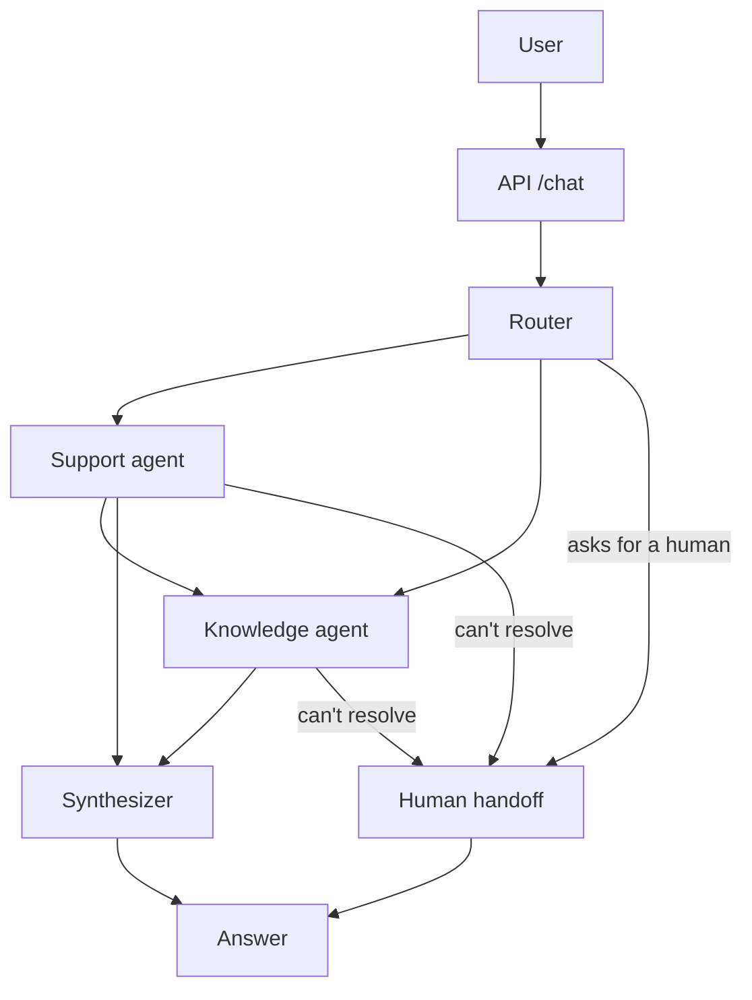

# Getnet multi-agent support

A small multi-agent assistant for Getnet customers. A router reads the message and decides who answers: a knowledge agent (Getnet website via RAG, or the web) and/or a support agent (the customer's own account data). If nobody can solve it, a human takes over. There's also an offline evaluator that scores the whole thing.

Stack: LangGraph, Groq (`gpt-oss-120b` for knowledge, `gpt-oss-20b` for the rest, `qwen3.8-27b` as judge), Voyage embeddings, Chroma, Tavily, FastAPI, Docker.

Demo video: https://youtu.be/bnBYBmf2AlQ

More docs: [SPEC](docs/SPEC.md)

## How it works



1. The router picks the agents (`support`, `knowledge`, both, or none) and detects the language. If both are needed, support goes first so knowledge can use what it found.
2. Each agent uses tools. Support reads account data, knowledge searches the Getnet KB (Chroma) or the web (Tavily).
3. The synthesizer builds the final reply: none ran → answers directly, one → passes it through, two → merges them.
4. If the user asks for a person, or nobody could resolve it, the handoff node opens a ticket, saves a record in `data/handoffs.jsonl` and tells the user.

The response also includes which agents ran, the tools they called and the sources, so it's easy to debug.

## Run it

```bash
cp .env.example .env            # add GROQ_API_KEY, TAVILY_API_KEY, VOYAGE_API_KEY

docker compose build
docker compose run --rm ingest  # builds the knowledge base (takes a while on Voyage's free tier)
docker compose up -d            # API on http://localhost:8000
```

```bash
curl -s -X POST http://localhost:8000/chat -H "Content-Type: application/json" \
  -d '{"message": "My card machine won'\''t connect to the internet, what should I do?", "user_id": "cliente1988"}'
```

Without Docker:

```bash
python -m venv .venv && source .venv/bin/activate     # Windows: .venv\Scripts\activate
pip install -r requirements-dev.txt
python -m app.rag.ingest
uvicorn app.main:app --reload
```

`python -m app.rag.ingest --from-cache` re-indexes without spending Tavily credits. `GET /health` shows how many chunks are in the KB.

**Demo customers** (fake data):

| user_id | What's going on |
|---|---|
| `cliente1988` | Terminal offline (weak Wi-Fi), pending payouts, two declined sales |
| `cliente2024` | Healthy account, Pix on |
| `cliente3030` | Printer out of paper, one open ticket, Pix off |

## Human handoff

Three triggers:

| Trigger | When |
|---|---|
| `user_requested` | The user asks for a human (any language). Agents are skipped. |
| `technical_failure` | Every agent failed. High priority. |
| `agent_unresolved` | Every agent called its `escalate_to_human` tool. |

If only one of two agents couldn't resolve it, we don't escalate, the user already got something useful.

A few things I learned while building it:

- **Retrieval score doesn't work as a trigger.** Answerable questions scored 0.41-0.67 and unanswerable ones 0.37-0.50, so any threshold is wrong either way.
- **Tool instead of a text marker.** First version had agents add `[[UNRESOLVED]]` to their reply. It showed up even on good answers (it caused false handoffs in the eval). An explicit `escalate_to_human(reason)` tool call fixed that.
- **The user only sees the handoff notice.** Whatever the unresolved agent found goes to the human, not the customer.
- **A broken notifier never breaks the reply.**

## Design notes

- **Plan first, then run.** One router call and then the agents run in order. Cheaper and more predictable than a supervisor loop, and easy to test.
- **Customer isolation.** Support tools are created per request already tied to the `user_id` and take no user argument, so a prompt like "show me cliente2024's data" can't change whose data is read.
- **Retrieval.** Contracts/manuals are ~60% of the chunks and crowded out the useful pages, so search returns 3 web pages + max 2 PDFs.
- **Fails softly.** If something breaks the request continues with `degraded: true`, and if everything fails it goes to a human. The API shouldn't 500 because of the LLM.
- **Per-turn reset.** The router resets the per-turn state, so nothing leaks between turns.
- **Fake customer data** lives behind `app/data/repository.py`. Replace that class to use a real backend.

## Tests and evaluation

```bash
pytest -q                            # 67 tests, no network or keys needed
docker compose run --rm eval         # full evaluation (needs keys + KB)
python -m eval.run_eval --only q05   # just some cases
```

The tests cover tools, router, ingestion, the API, handoff and the graph itself (real graph, stub agents).

The evaluation has 17 cases (10 from the challenge + extras + 3 handoff cases). Each one checks routing, tool use and handoff, and an LLM judge (different model family) scores relevance, groundedness, completeness and tone. Reports go to `eval/reports/latest.md`.

Latest report (`eval/reports/latest.md`): routing 100%, tools 100%, judge pass rate 93%, p50 6.8 s. The one failure was a factual slip that didn't repeat in 3 retries.

Handoff behavior: explicit requests for a human always escalated. The unanswerable loan question escalated most of the time but not always, since the agent decides whether to call `escalate_to_human` (see Limitations).

## Limitations

- Memory is in-process (`MemorySaver`), so it resets when the container restarts.
- Customer data is fake.
- Nothing reads the handoff queue. It's a file, so the "a human will follow up" message is not really backed by anyone yet. A real setup needs Slack/Teams/helpdesk behind `HandoffNotifier`.
- Whether an agent escalates is the LLM's call, so it can miss sometimes.
- The KB is only as good as the crawl. There's little troubleshooting content, so those answers are generic. Adding help-center URLs to `app/rag/sources.py` would help the most.
- The LLM judge isn't ground truth, so spot-check the answers.
- No auth: `user_id` is trusted as given.
- Not done: guardrails, tracing/dashboards.

## Layout

```
app/
  main.py service.py graph.py handoff.py state.py prompts.py config.py ...
  agents/   router, knowledge, support, synthesizer
  tools/    customer_tools, knowledge_tools, handoff_tools
  rag/      sources, ingest, store
  data/     customers.json, repository.py
eval/       dataset.jsonl, judge.py, run_eval.py
tests/
docs/
```
