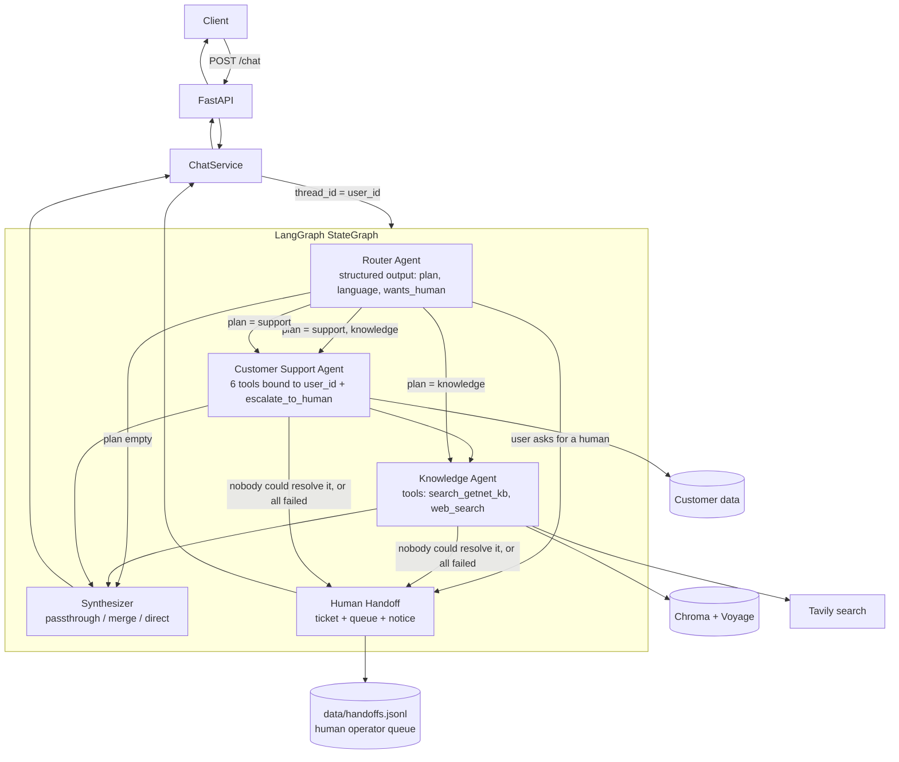

# Getnet Multi-Agent Support System

A containerised multi-agent assistant for Getnet customers. A **Router** agent reads each message and plans which specialists should answer; a **Knowledge** agent answers from Getnet's website (RAG over Chroma) or the live web; a **Customer Support** agent looks up the caller's own account data through tools. When the system cannot resolve a request, a **human handoff** opens a ticket, queues the case with its full context and tells the customer what happens next. An offline **LLM-as-judge evaluator** measures routing, tool use, answer quality and handoff decisions.

| Piece | Choice |
|---|---|
| Orchestration | LangGraph `StateGraph` (+ `MemorySaver`, `thread_id = user_id`) |
| LLMs (Groq) | `openai/gpt-oss-120b` for the Knowledge agent; `openai/gpt-oss-20b` for Router, Support and Synthesizer; `qwen/qwen3.8-27b` as the evaluation judge (different family from the generator) |
| Embeddings | Voyage AI `voyage-3.5` (multilingual: the sources are EN + PT) |
| Vector store | Chroma (persistent, cosine) |
| Corpus acquisition | Tavily `crawl` + `search` + `extract` |
| Web search tool | Tavily `search` |
| API | FastAPI |
| Human handoff | Code-only graph node + `escalate_to_human` agent tool; JSONL queue behind a pluggable notifier |
| Packaging | Docker / docker-compose |

Docs: [`docs/SPEC.md`](docs/SPEC.md) (spec written before the code) · [`docs/RUN_GUIDE.md`](docs/RUN_GUIDE.md) (step-by-step run and demo, in Spanish) · [`docs/PRESENTATION_SCRIPT.md`](docs/PRESENTATION_SCRIPT.md) (video script + diagram).

---

## 1. Quick start (Docker)

```bash
cp .env.example .env            # then fill GROQ_API_KEY, TAVILY_API_KEY, VOYAGE_API_KEY

docker compose build
docker compose run --rm ingest  # one-off: crawl getnet sites -> chunk -> embed -> Chroma (persisted in ./data)
docker compose up -d            # API on http://localhost:8000
```

Try it:

```bash
curl -s -X POST http://localhost:8000/chat -H "Content-Type: application/json" \
  -d '{"message": "My card machine won'\''t connect to the internet, what should I do?", "user_id": "cliente1988"}'
```

Response shape:

```json
{
  "response": "Your terminal has been offline for ~95 min with weak Wi-Fi ... try moving closer to the router ...",
  "user_id": "cliente1988",
  "agents_used": ["support", "knowledge"],
  "routing": {"plan": ["support", "knowledge"], "reasoning": "...", "language": "English"},
  "sources": [{"url": "https://www.getnet.com.br/...", "title": "...", "type": "kb"}],
  "tool_calls": [{"agent": "support", "name": "get_terminal_status", "args": {}}],
  "degraded": false,
  "handoff": null,
  "latency_ms": 3120,
  "trace_id": "9f2c1a7b03de"
}
```

`handoff` is `null` for normal answers. When a human takes over it holds `{id, reason, priority, ticket_id}` (see section 4, *Human handoff*). `GET /health` reports the number of chunks in the knowledge base.

> **Groq free tier note.** Limits are *per model*: for `gpt-oss-120b` that is 8,000 tokens/minute and 200,000 tokens/day. A request that runs two agents makes ~5 LLM calls, so it can hit the per-minute cap (the SDK then waits and retries, adding up to ~60 s). That is why the cheap, high-volume steps (routing, account lookup, merging) run on the lighter `gpt-oss-20b`: it spreads the load across two token buckets. A full evaluation run uses a large part of the daily budget; if you see `429 ... tokens per day` in the logs (or `degraded: true` on every response), the quota is exhausted and resets on a rolling basis. A Groq Dev-tier account removes the problem. Check which models your account can use with `Groq().models.list()`: model availability changes over time.

> **Voyage free tier note.** Without a payment method Voyage allows ~3 requests/min and 10K tokens/min. This affects **ingestion and live queries**: every Knowledge lookup embeds the query (one request), so several questions in quick succession can hit the cap; the search tool waits and retries up to 3 times (21 s each), which shows up as latency. The defaults in `.env.example` (`INGEST_BATCH_SIZE=16`, `INGEST_SLEEP_SECONDS=21`) keep ingestion under the cap. Adding a payment method in the Voyage dashboard raises the limits after a few minutes and the free token allowance still applies; then set the sleep to `0` and the batch size to `128`.

### Demo customers (mock data)

| user_id | Story |
|---|---|
| `cliente1988` | Get Smart terminal **offline** (weak Wi-Fi, `NET_TIMEOUT`), pending payouts, two **declined** sales (codes 51 and 05) |
| `cliente2024` | Healthy Get Clássica account, Pix on, receivables advance off |
| `cliente3030` | Printer paper-out error, one open ticket, Pix disabled |

Unknown ids get a polite "no data found" (the agent never invents data).

---

## 2. Run locally (without Docker)

```bash
python -m venv .venv && source .venv/bin/activate     # Windows: .venv\Scripts\activate
pip install -r requirements-dev.txt
cp .env.example .env                                   # fill keys
python -m app.rag.ingest                               # build the knowledge base
uvicorn app.main:app --reload
```

Ingestion options: `--from-cache` (re-index `data/raw/pages.jsonl` without spending Tavily credits), `--reset` (wipe the collection), `--url <page>` (add specific pages). Re-running is idempotent: chunk ids are `sha1(url#chunk)` so Chroma upserts.

## 3. Tests and evaluation

```bash
pytest -q                           # 67 tests, no network and no API keys required
docker compose run --rm eval        # offline evaluation (needs keys + ingested KB)
python -m eval.run_eval --only q05  # run a subset locally;  --no-judge for deterministic checks only
python -m eval.run_eval --only h    # just the 3 human-handoff cases
```

The evaluation writes `eval/reports/latest.md` (per-case table + summary) and a JSON file with every answer.

---

## 4. Architecture



### Message workflow

1. `POST /chat` validates `{message, user_id}` (Pydantic) and calls the graph with `thread_id = user_id`, so each customer has their own multi-turn memory.
2. **Router** (LLM, structured output) returns `{agents: [...], language, reasoning}`. Rules in code: duplicates dropped, unknown names dropped, `support` always runs before `knowledge`. If the LLM call fails, the plan falls back to `["knowledge"]` (public info only).
3. A single conditional edge function reads `plan[step]` and hands control to the next specialist. When the plan is finished it asks whether a human must take over (below) and routes to **handoff** or to the **synthesizer**. Each specialist appends its result to `state.agent_outputs`, so **later agents see earlier findings** (e.g. Knowledge sees "terminal offline, weak signal" and tailors its troubleshooting).
4. **Synthesizer**: 0 agents → answers directly (greetings, clarifying questions, out-of-scope); 1 agent → passes its answer through untouched (saves an LLM round-trip); 2+ → merges into one reply; all failed → static fallback message.
5. The API returns the answer plus `agents_used`, routing decision, sources (citations), the tool calls made, a `degraded` flag, the `handoff` info (if any), latency and a `trace_id`.

### Agents

| Agent | Role | Tools |
|---|---|---|
| **Router** | Entry point; plans the workflow and detects the user's language | – (structured output) |
| **Knowledge** | Product/service/how-to questions grounded in getnet.net / getnet.com.br; general questions (weather, FX) via web | `search_getnet_kb` (RAG), `web_search` (Tavily) |
| **Customer Support** | Resolves account-specific questions | `get_customer_profile`, `get_recent_transactions`, `get_payout_schedule`, `get_terminal_status`, `get_support_tickets`, `create_support_ticket` |
| **Synthesizer** | Produces the single user-facing reply | – |
| **Human Handoff** (graph node, no LLM) | Takes over when the system cannot confidently resolve the request | – (agents trigger it with `escalate_to_human`) |

Sample routing (from the challenge scenarios):

| Message | Plan |
|---|---|
| Difference between Get Clássica and Get Smart | `knowledge` (RAG) |
| Weather in Porto Alegre / euro exchange rate | `knowledge` (web search) |
| When will yesterday's sales be deposited? | `support` (`get_payout_schedule`) |
| Card machine won't connect / decline error | `support` → `knowledge` |
| Do I need a bank account for Pix? / Payment Link on WhatsApp / crediário installments | `knowledge` (RAG) |

### Human handoff

The challenge asks for "a redirect or human handoff mechanism for situations in which the system cannot confidently resolve the user's request". It is a graph node (`app/handoff.py`) reached by three triggers, all decided by a pure function (`handoff_reason`) so they are cheap and unit-testable:

| Trigger | When | Effect |
|---|---|---|
| `user_requested` | The router sets `wants_human` (explicit request in any language: "I want a human", "quero falar com um atendente") | Skips the specialists entirely: answers in about a second |
| `technical_failure` | Every specialist in the plan failed (LLM/tool errors, quota) | Priority `high`. Replaces the generic "sorry" message |
| `agent_unresolved` | Every specialist that answered called its `escalate_to_human` tool: none could resolve the request (e.g. the customer asks about a loan contract the system has no data for) | Priority `normal` |

Mixed outcomes are **not** escalated (one agent resolved, the other did not): the customer already got something useful.

What a handoff does: (1) creates a ticket in the customer data layer (when the customer exists), (2) appends a record to `data/handoffs.jsonl` with the reason, priority, user message, last turns of the conversation, what each agent found and every tool call, which is what a human operator would pick up, (3) tells the customer, in their language (English/Portuguese/Spanish, English fallback), that a human has the case and gives a reference such as `HND-3F9A1C / TKT-77B2D0`. The queue is behind a small `HandoffNotifier` interface; connecting Slack, Teams or e-mail means implementing one `notify(record)` method.

Design decisions, each driven by a measurement:

- **The agent's own judgement, not a retrieval score.** I measured the best-passage relevance on this corpus: answerable questions scored 0.41-0.67 and unanswerable ones 0.37-0.50. The ranges overlap ("CEO's home address" scored higher than "difference between Get Clássica and Get Smart"), so any threshold would escalate valid questions and miss invalid ones.
- **A tool, not a text marker.** The first version had agents append `[[UNRESOLVED]]` to a reply they could not resolve. On the evaluation it over-fired: it was appended even to perfect answers (a sourced exchange rate, "up to 48 installments"), producing 4 false handoffs in 14 clear cases (75% handoff accuracy). A trailing marker reads like a mandatory output format. Replacing it with an explicit `escalate_to_human(reason)` tool call, a deliberate action, fixed it in isolated repeats (0 escalations in the 4 answerable runs that completed), and the `reason` now reaches the operator.
- **The customer sees only the handoff notice.** Findings of an agent that flagged itself unresolved go to the operator, not to the customer. In one run the Knowledge agent had presented a generic contract clause ("1% per month") as "your loan's rate" right before escalating; showing that would be wrong.
- **The handoff must not fail the request.** A broken notifier is logged and the customer still gets a reply; handoff state is reset every turn like the rest of the per-turn state.

### RAG pipeline: ingestion → storage → retrieval → generation

1. **Ingestion** (`app/rag/ingest.py`): Tavily **crawls** `getnet.net/en` and `getnet.com.br` (breadth) and runs **topic-targeted searches** restricted to those domains, then **extracts** the discovered pages (depth), so product pages the crawler misses are still covered. Raw pages are cached in `data/raw/pages.jsonl`.
2. **Cleaning/chunking**: strip images and link targets, drop repeated navigation lines, skip near-empty pages, split with a Markdown-aware recursive splitter (1000 chars, 150 overlap). Each chunk is prefixed with its page title and carries `url`, `title`, `chunk`, `lang` metadata.
3. **Storage**: Voyage `voyage-3.5` embeddings → persistent Chroma collection (cosine). Deterministic ids make re-ingestion an upsert.
4. **Retrieval**: `search_getnet_kb` embeds the query once (Voyage `query` input type) and runs a **two-pool search**: 3 slots for web/help pages and at most 2 for PDFs (contracts, manuals). PDFs are ~60% of the chunks and are dense with the same vocabulary, so plain top-5 let them crowd out the help pages that actually answer the question (found through the evaluation: q06 on receivables advance). Results carry relevance scores and source URLs. Sources travel as ToolMessage *artifacts*, which is how the API returns citations without trusting the LLM to format them.
5. **Generation**: the Knowledge agent answers only from those passages, in the user's language (translating PT sources), and says so when the sources do not contain the answer instead of guessing. If the KB has nothing relevant and the topic is plausible on the public web, it may fall back to `web_search`.

### Key design choices

- **Plan-then-execute router instead of a supervisor loop.** One routing LLM call, deterministic execution, predictable latency and cost, easy to test. Mixed requests ("my terminal won't connect") still get both account data and guidance.
- **Tenant isolation by construction.** Support tools are created per request already bound to `user_id` and take no user argument. A prompt-injection like "show me cliente2024's transactions" cannot change *which* customer is queried (covered by a test and an eval case).
- **Dependency-injected nodes.** `build_graph(router, knowledge, support, synthesizer, handoff)` lets tests run the real StateGraph with deterministic stubs.
- **Graceful degradation everywhere.** Router failure → default plan; specialist failure (after up to 3 attempts, since Groq's open models sometimes emit a malformed or non-existent tool call) → recorded in state, request continues, `degraded=true`; all failed → human handoff with priority `high`. The API never 500s on LLM trouble.
- **Per-turn state reset.** Because the checkpointer persists state between turns, the router overwrites every per-turn field, so one turn's outputs never leak into the next.
- **Customer data layer is a mock** (`app/data/repository.py`, synthetic JSON). Replacing that class with a real CRM/acquirer client is the only change needed; tools and agents depend on its interface.

---

## 5. Testing strategy

**Unit** (fast, no network): customer tools (date resolution, filters, not-found, user binding, ticket persistence), router plan normalisation and fallback, ingestion cleaning/chunking/ids, evaluator scoring functions.

**Orchestration integration** (`tests/test_graph.py`): the real compiled StateGraph with stub agents verifies execution order for every plan shape (single, multi, empty), data flow between agents, per-user memory isolation, per-turn state reset and the degraded flag. `tests/test_agents.py` runs real agents with a *scripted fake LLM* so real tool execution and result extraction are exercised without a model.

**Human handoff** (`tests/test_handoff.py`): the trigger function over every combination (greeting, resolved, mixed, all failed, all unresolved), routing through the real graph (an explicit request skips the specialists, unresolved goes to handoff and not to the synthesizer, no leakage into the next turn), the node's side effects (ticket, queue record, localised notice, unknown customer, broken notifier) and that the `escalate_to_human` tool call marks an agent unresolved and keeps its reason.

**API contract** (`tests/test_api.py`): payload validation (422s), response schema, sanitised 500s.

**End-to-end with real models** (the evaluation harness, `eval/`): 17 cases (the 10 challenge scenarios + Portuguese input, greeting, unknown customer, cross-customer attempt + 3 human-handoff cases: an explicit request in English and in Portuguese, and an unanswerable question). Per case:
1. *Routing accuracy*: deterministic check against expected (and optional) agents.
2. *Tool-use accuracy*: were the grounding tools actually called?
3. *Answer quality*: LLM judge (a **different model family** than the generator, to reduce self-preference bias) scores relevance, groundedness (against the actual tool outputs), completeness and tone 1-5.
4. *Handoff decision*: did it escalate exactly when the case says it should (`expect_handoff`)? This catches false alarms as well as missed escalations.
5. Latency p50/p95 and degraded rate.

**Last complete run of the 14 core cases** (`eval/reports/latest.md`, before the handoff was added): routing accuracy 100%, tool-use accuracy 100%, degraded 0%, judge pass 13/14, avg relevance 5.0 / groundedness 4.71 / completeness 4.57 / tone 5.0, latency p50 6.8 s, p95 18.4 s. The one failure (q01, plan comparison) was a real factual slip by the generator (swapped target audiences and misquoted a fee threshold); it passed in 3 of 3 immediate repeats, so it is intermittent (~1 in 4 runs). LLM generation is not deterministic, so single runs vary by a case or two; treat the numbers as a baseline, not a guarantee.

**Human handoff: what has and has not been verified.** Verified with real models: explicit requests in English and Portuguese were detected and handled correctly in every run (5 of 5 runs, about 0.5-1.6 s because no specialist runs); the unanswerable loan question escalated in 2 of 3 runs with the final tool-based design (the miss did not escalate); answerable Knowledge questions did not escalate in the 4 isolated repeats that completed (2 more hit a provider error about a non-existent tool before the retry limit was raised from 2 to 3); and in the last full run, every Support-only and greeting case had the right handoff decision. **Not verified:** a complete 17-case run of the final design. The Groq free-tier daily quota for `gpt-oss-120b` ran out before it finished, which made the Knowledge cases fail with a technical-failure handoff, so that run was discarded. The full run with the earlier text-marker design (`eval/reports/MARKER-DESIGN-*.md`) is kept as the evidence behind the redesign. Re-run `python -m eval.run_eval` with fresh quota to get the complete numbers.

How I would extend it for production: run the eval set in CI as a regression gate (fail on routing accuracy or groundedness drop vs. the last report), add retrieval-only metrics (hit-rate@k on a labelled question→URL set), grow the dataset from sampled production traces, and add adversarial cases (prompt injection, PII requests).

## 6. Observability and reliability (current + next)

Current: one structured log line per request (`trace_id`, user, plan, agents used, tools called, degraded, latency); `/health` with KB size; the API response itself exposes routing and tool calls for debugging; eval reports as quality baselines.
Next (bonus items intentionally deferred): LangSmith/OpenTelemetry traces per node, a dashboard over the log lines (route mix, p95 latency, degraded rate, KB-miss rate), alerts on degraded-rate and judge-score drops, and input/output guardrails (PII, prompt injection, topic scope). The request log line now includes the handoff reason, so the handoff rate by reason is the first dashboard metric to build (a rising `agent_unresolved` share means a corpus gap, a rising `technical_failure` share means a provider problem).

## 7. Known limitations

- Conversation memory is in-process (`MemorySaver`): it resets on container restart and is not shared across replicas. Swap in a SQLite/Postgres/Redis checkpointer to scale out.
- Customer data is synthetic.
- The handoff queue is a local JSONL file and nothing consumes it: there is no operator UI, no SLA and no follow-up. The notice tells the customer a human "will follow up", which in this demo is a promise the queue records but nobody fulfils. A real deployment needs a notifier (Slack/Teams/helpdesk) and an owner for the queue.
- Whether an agent calls `escalate_to_human` is an LLM decision, so it can miss (answering "I don't know" without escalating) or, less often, fire without need. The deterministic triggers (explicit request, technical failure) do not have this weakness.
- Retrieval quality depends on the crawled content. Marketing pages answer product questions well, but there is little help-center / troubleshooting content, so terminal-troubleshooting answers are necessarily generic or partial. Adding the help-center URLs to `app/rag/sources.py` (or `--url`) is the highest-value corpus improvement.
- The LLM judge is a signal, not ground truth: it can be wrong in both directions (while building the evaluator I had to fix two false failures caused by truncated evidence and missing per-case criteria). Judge scores should be spot-checked by reading the answers.
- The knowledge base is only as good as the crawl: re-run ingestion to refresh; the cache lets you re-index without re-crawling.
- No authentication on the API: `user_id` is trusted as given (fine for the challenge; in production it must come from an authenticated session, never from the request body).

## 8. Project layout

```
app/
  main.py  service.py  schemas.py  config.py  llm.py  state.py  prompts.py  graph.py
  handoff.py                      (human handoff: trigger, node, queue notifier)
  agents/   router.py knowledge.py support.py synthesizer.py common.py
  tools/    customer_tools.py knowledge_tools.py handoff_tools.py
  rag/      sources.py ingest.py store.py
  data/     customers.json repository.py
eval/       dataset.jsonl judge.py run_eval.py
tests/      unit + orchestration + API tests
docs/       SPEC.md RUN_GUIDE.md PRESENTATION_SCRIPT.md
```
