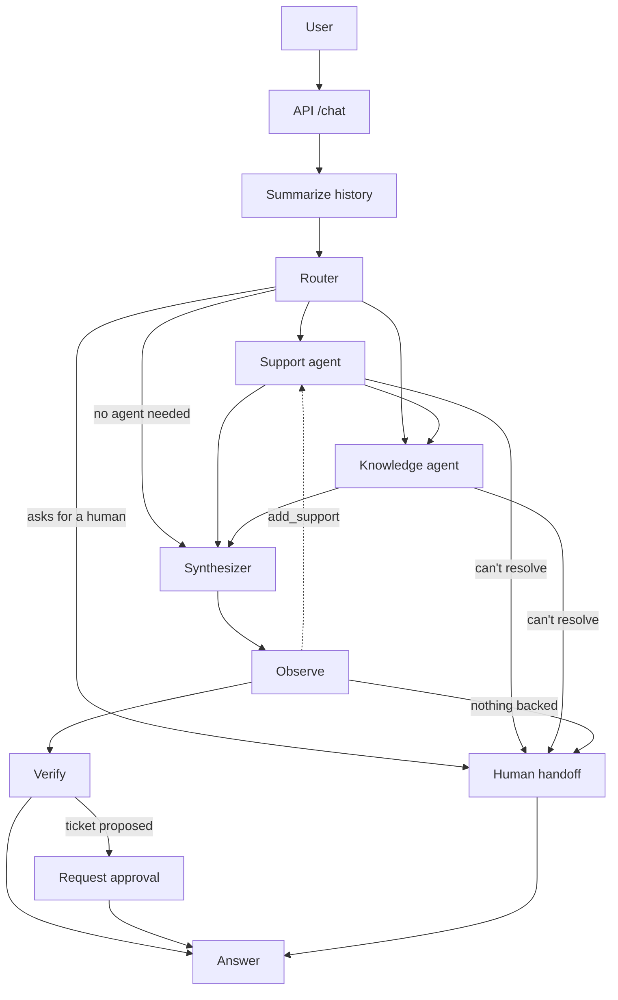

# Getnet multi-agent support

A multi-agent assistant for Getnet customers. A router reads each message and decides who answers: a **knowledge agent** (Getnet website via RAG, or the web) and/or a **support agent** (the customer's own account data). If nobody can solve it, a human takes over through an operator queue. An offline evaluator scores the whole system.

**Stack:** LangGraph, `gpt-oss` models on Groq or Fireworks (`AGENT_PROVIDER`), `qwen3.8-27b` on Groq as the eval judge, Voyage embeddings, Chroma, Tavily, FastAPI, SQLite, Docker.

Demo video: https://youtu.be/bnBYBmf2AlQ

**Read first (three things a reader of the numbers needs):**
- **`REPLAN_MAX=0` is the default** because the replan step has no demonstrated quality benefit and adds cost and latency when it acts. Two sources, neither of which shows a benefit: the comparison on the regular cases ([the review response, "Why `REPLAN_MAX=0` is the default"](docs/REVIEW_RESPONSE.md#notes-under-the-table) and the generated [`REPLAN-AB-20261116-234030.md`](eval/reports/REPLAN-AB-20261116-234030.md)) and the preregistered probe of 2026-11-18, whose headline under its rule is generated ([`REPLAN-PROBE-20261118-133249.md`](eval/reports/REPLAN-PROBE-20261118-133249.md); the detail is in [the replan demo](docs/REPLAN_DEMO.md#the-replan-probe-2026-11-18-the-step-on-against-the-step-off-on-cases-written-to-make-it-act)):

<!-- probe:readme_outcome:start -->
> **Outcome of the preregistered rule: null.** Net +0, inside +/-2.
<!-- probe:readme_outcome:end -->
- **The regular pass rate of the results block is not comparable with the one of 12 November.** The judge changed (another, stricter one) and the answers, cases and prompts changed too; the three calibrations used different judges and samples: [final report, section 3](docs/FINAL_REPORT.md#3-does-the-judge-agree-with-a-human-v3) and [section 7, item 2](docs/FINAL_REPORT.md#7-disclosures-and-limitations), [`CALIBRATION_V3.md`](eval/calibration/CALIBRATION_V3.md). No judge rate is typed in these lines: they are generated, see [Results](#results).
- **What is verified in CI, what was captured and what was checked by hand** (captured on 2026-11-18 with the output saved in `docs/evidence/`: Keycloak, one Jaeger trace, Prometheus, promtool; by hand, with no artifact: Grafana and a ticket approval with a real model; failover only with test doubles): [the evidence map, "What the CI checks and what is manual"](docs/EVIDENCE.md#what-the-ci-checks-and-what-is-manual). Results of runs on GitHub are the owner's account and are not verifiable from a checkout.

**Docs:** [Review response](docs/REVIEW_RESPONSE.md) (each point of the external review, with its status and evidence) · [Evidence map](docs/EVIDENCE.md) (a claim -> the file, the test and the report that back it) · [SPEC](docs/SPEC.md) (requirements and the test or eval case that checks each one) · [Final evaluation report](docs/FINAL_REPORT.md) (what was run, the numbers, the disclosures) · [A real replan, step by step, and the replan probe](docs/REPLAN_DEMO.md) · [Scaling beyond one worker](docs/SCALING.md) (a design, not implemented) · [Challenge statement](docs/CHALLENGE.md)

## How it works



The dotted `add_support` edge is drawn as a loop to the support agent, but `observe` calls that node itself and merges the answers with the synthesizer's own merge prompt; it is not a LangGraph edge. Both edges that leave `observe` for the support agent or for the human only exist with `REPLAN_MAX=2` (any larger value behaves like 2): `add_support` acts when the router sent only the knowledge agent and an unsupported claim is about the customer's own account, and the `nothing backed` edge sends the case to a human when no claim of the answer is backed by the evidence and the answer had steps. With the default `REPLAN_MAX=0` `observe` does nothing, and with `REPLAN_MAX=1` it only retries the knowledge base once; `request_approval` exists only in the API and only while `APPROVAL_REQUIRED_CATEGORIES` is not empty; the eval runs without it.

1. The router picks the agents (`support`, `knowledge`, both, or none) and detects the language. If both are needed, support goes first so knowledge can use what it found.
2. Each agent uses tools. Support reads account data; knowledge searches the Getnet knowledge base (Chroma) or the web (Tavily).
3. The synthesizer builds the final reply: no agent ran → answers directly, one → passes it through, two → merges them.
4. If the user asks for a person, or nobody could resolve the request, the handoff node opens a ticket, queues the case for the operators and tells the user.
5. After the synthesizer, two steps look at the answer before it is sent. **`observe`** (off by default, `REPLAN_MAX=0`) audits it against the evidence; if some claims have no support it first searches the knowledge base once more with those claims grouped (one Voyage call), checks again against the new passages, and deletes only what is still unsupported. With `REPLAN_MAX=2` it takes one more action, the first that applies: **`add_support`** (the router sent only the knowledge agent and an unsupported claim is about the customer's own account: the support agent runs with the authenticated user id, the two answers are merged and the merge is audited again), or else it offers a ticket when no actionable step is left, or sends the case to a human when nothing in the answer is backed. If `add_support` fails, the turn falls back to the ticket offer or the escalation. **`verify`** deletes the unsupported claims (if `observe` did not), makes the answer match the customer's language, and replaces an answer that repeats the system prompt (10+ consecutive words) with a short refusal. What `observe` did is in `routing.replans` of the response.

The response also lists which agents ran, the tools they called, the sources and the token usage, so it is easy to debug.

**Design choices**

- **Plan first, then run.** One router call, then the agents run in order. Cheaper and more predictable than a supervisor loop, and easy to test.
- **Customer isolation.** The customer is the authenticated JWT `sub`, never something in the body or the prompt. Support tools are created per request, already tied to that customer, and take no user argument, so "show me cliente2024's data" cannot change whose data is read. A test inspects the schema of every tool and fails if one exposes a parameter that selects a user.
- **Retrieval.** Contracts and manuals are ~60% of the chunks and crowded out the useful pages, so search returns 3 web pages + at most 2 PDFs.
- **Fails softly.** If something breaks, the request continues with `degraded: true`; if every agent fails, the case goes to a human. The API does not 500 because of the LLM.
- **Handoff by tool, not by score.** Retrieval scores overlap between answerable (0.41-0.67) and unanswerable (0.37-0.50) questions, so no threshold works. Agents call an explicit `escalate_to_human(reason)` tool instead.
- **Fake customer data** lives behind `app/data/repository.py`; replace that class to use a real backend.

## Run it

```bash
cp .env.example .env
# add GROQ_API_KEY (the judge), FIREWORKS_API_KEY, TAVILY_API_KEY, VOYAGE_API_KEY, and two long random values the
# demo identity provider needs (compose refuses to start without them, and they are never written in a repo file):
#   KEYCLOAK_ADMIN_PASSWORD, DEMO_USER_PASSWORD     python -c "import secrets; print(secrets.token_urlsafe(24))"

docker compose build
docker compose run --rm ingest  # builds the knowledge base (slow on Voyage's free tier)
docker compose up -d            # Keycloak on http://localhost:8180 (first start ~30 s), API on http://localhost:8000
```

```bash
# the API needs a JWT (see Authentication). Ask the identity provider for one, as the demo customer cliente1988:
TOKEN=$(python -m scripts.issue_token --user cliente1988 | head -1)    # needs DEMO_USER_PASSWORD in the shell

curl -s -X POST http://localhost:8000/chat \
  -H "Authorization: Bearer $TOKEN" -H "Content-Type: application/json" \
  -d '{"message": "My card machine won'\''t connect to the internet, what should I do?"}'
```

`scripts/` is a development helper and is **not** in the Docker image, so run it from your checkout (`pip install -r requirements-dev.txt`).

Without Docker for the API (Keycloak still comes from compose: `docker compose up -d keycloak`). In your `.env`, uncomment `JWKS_URL` and `OPERATOR_JWKS_URL`: they are commented out in `.env.example` because inside Docker compose supplies the service-name URLs (`http://keycloak:8080/...`), and `localhost:8180` there would be the API container itself.

```bash
python -m venv .venv && source .venv/bin/activate     # Windows: .venv\Scripts\activate
pip install -r requirements-dev.txt
python -m app.rag.ingest
uvicorn app.main:app --reload                         # reads the auth variables of .env
python -m scripts.issue_token --user cliente1988      # prints a token and an example curl
```

`python -m app.rag.ingest --from-cache` re-indexes without spending Tavily credits. `GET /health` shows how many chunks are in the knowledge base.

**Demo customers** (fake data):

| Token `sub` | What's going on |
|---|---|
| `cliente1988` | Terminal offline (weak Wi-Fi), pending payouts, two declined sales |
| `cliente2024` | Healthy account, Pix on |
| `cliente3030` | Printer out of paper, one open ticket, Pix off |

### Configuration

Everything comes from `.env` (see [.env.example](.env.example): every setting of `app/config.py` appears there with a value, some of them commented out). `docker-compose.yml` passes the model variables to the containers.

| Variable | Role | Default |
|---|---|---|
| `AGENT_PROVIDER` | Provider of every agent: `groq` (`GROQ_API_KEY`) or `fireworks` (OpenAI-compatible API, `FIREWORKS_API_KEY`). The judge is always Groq | `groq` |
| `LLM_MODEL` | Knowledge agent | `openai/gpt-oss-120b` |
| `LIGHT_MODEL` | Router, synthesizer, rolling summary | `openai/gpt-oss-20b` |
| `SUPPORT_MODEL` | Support agent | empty = same as `LIGHT_MODEL` (`.env.example` sets `openai/gpt-oss-120b`) |
| `JUDGE_MODEL` | Eval judge (a different model family) | `qwen/qwen3.8-27b` |
| `FALLBACK_PROVIDER` | The other provider that answers when `AGENT_PROVIDER` has an outage (5xx, 429, no connection, timeout): the same model under its id there. Empty = no failover | empty (compose: `fireworks` for the API, empty for the eval) |
| `APPROVAL_REQUIRED_CATEGORIES` | Ticket categories a person must approve before the ticket is opened (empty = none). `APPROVAL_TTL_MINUTES` (60) is how long a request may wait | all five categories |
| `WEBHOOK_URL`, `WEBHOOK_SIGNING_KEY` | Push to the operators: an HTTPS POST for each new handoff, ticket request waiting for approval and handoff past its SLA. Empty URL = off; the key is required with a URL | empty |
| `HANDOFF_SLA_MINUTES` | A handoff nobody claims within this time is escalated once (priority high, audit event, webhook). 0 = off | 30 |
| `METRICS_TOKEN` | Bearer token for `GET /metrics` (Prometheus). Empty = the endpoint does not exist | empty |
| `OTLP_ENDPOINT` | Where to send one trace per turn (OTLP/gRPC, e.g. `http://jaeger:4317`). Empty = no traces | empty |
| `RAG_MODE` | How the knowledge base is searched: `dense`, `hybrid` (+ BM25, RRF) or `hybrid_rerank` (+ Voyage reranker). See Results | `dense` |
| `REPLAN_MAX` | What the `observe` step may do about unsupported claims. `0` = nothing (the graph as it was); `1` = one more knowledge-base search before deleting; `2` or more = also `add_support`, a ticket offer or an escalation (one action per turn; a larger value behaves like 2). Measured, not adopted: see `docs/FINAL_REPORT.md`, section 4 | `0` |
| `VERIFIER_MODE` | How the `verify` step lists the claims to check: `statements` (the model lists them, the code checks each quote) or `segments` (the code splits the answer and the model answers for every segment; evaluated and not adopted, see below) | `statements` |

The `.env.example` setting for Support is deliberate: on a declined payment the 20b often skips `get_recent_transactions` and blames the terminal, while the 120b calls it every time. Groq's free tier limits tokens per model (gpt-oss: 8K per minute, 200K per day), so roles that share a model share one quota; that is why the light roles run on a different model than Knowledge.

With `AGENT_PROVIDER=fireworks` the model variables take Fireworks ids. The account used for the published reports serves only `accounts/fireworks/models/gpt-oss-120b`, so every role runs on it there. One run can override the models: `LIGHT_MODEL=openai/gpt-oss-120b docker compose run --rm eval`.

## API

| Endpoint | Who | What |
|---|---|---|
| `GET /health` | public | Status and knowledge-base size |
| `POST /chat` | merchant | Send a message; body `{"message", "conversation_id"?, "user_id"?}`. Without `conversation_id` the **server starts a new conversation** and returns its id; to continue, send that id back |
| `GET /conversations`, `GET` / `DELETE /conversations/{id}` | merchant | List, read and erase your own conversations |
| `GET /conversations/{id}/operator-messages` | merchant | Operator replies for a conversation |
| `GET /operator/handoffs`, `GET /operator/handoffs/{id}` | operator | The handoff queue and one case |
| `POST /operator/handoffs/{id}/claim`, `/reply`, `/reject` | operator | Work a case |
| `GET /operator/approvals`, `POST /operator/approvals/{id}/approve`, `/reject` | operator | Ticket requests waiting for a person, and the decision |
| `GET /operator/metrics` | operator | Latency, tokens, cost, handoff and error rates |

Interactive docs at `/docs` when the API is running.

## Authentication

`POST /chat` requires `Authorization: Bearer <jwt>`. `GET /health` is public. There are two kinds of caller, **merchants** (`/chat`, `/conversations`) and **operators** (`/operator/*`, see Human oversight), and each one has its own issuer, audience and signing keys.

- **Tokens are RS256 and checked against the identity provider's public keys (JWKS). There is no shared secret in the app.** Anybody who can read the whole container, the image or the repo still cannot mint a token. The demo identity provider is Keycloak (docker compose, `infra/keycloak`: two realms, `getnet-merchants` and `getnet-operators`, imported with no passwords in the files; users get `DEMO_USER_PASSWORD` from the environment). A real deployment points the six `JWKS_URL` / `JWT_ISSUER` / `JWT_AUDIENCE` variables (and the `OPERATOR_` ones) at its own identity provider.
- **How a token is checked** (`app/auth.py`): the header must say `alg: RS256`, the only accepted algorithm, fixed in code (there is no HS256 path, so no algorithm-confusion attack; `alg: none` is refused), must carry a `kid`, and may not carry `jku`, `jwk`, `x5u` or `x5c` (a token never tells the API where its key is). The `iss` must be exactly one of the two configured issuers: it only picks which public keys to use, and the signature is then checked against that issuer's keys alone. `exp`, `iat`, `iss`, `aud`, `sub` and `jti` are required. A token that lives longer than `JWT_MAX_LIFETIME_SECONDS` (900) is refused whatever the identity provider issues; Keycloak issues 5 minutes.
- **The JWKS cache** (`app/jwks.py`) keeps only RS256 signing keys that have a `kid` (Keycloak also publishes an encryption key; it is ignored). An unknown `kid` may trigger a re-fetch (the provider rotated its keys) **at most once every `JWKS_MIN_REFRESH_SECONDS` (30)**, so random `kid` values cannot make the API hammer the provider. If the provider is down the cached keys keep working (nobody is logged out by an outage); a cache that never got a key refuses everything.
- **Who is calling comes only from the token.** `sub` is the customer (`user_id`). It goes to the tools, the memory thread, the tickets, the handoff records and the logs. The LLM never chooses it. The Support prompt does show the id (it comes from the verified token, never from the user's text) so the model can tell "my data" from someone else's; removing it made the cross-customer refusal case `x04` fail in 5 of 5 runs of an A/B test.
- **Roles come from the issuer.** A token signed by the operator realm is an operator; one signed by the merchant realm is a merchant, and a `role` claim may only agree with that. A merchant token on `/operator/*` is a valid merchant token and gets `403`; it cannot be turned into an operator token by editing its claims (that breaks the signature, and the operator keys are another issuer's).
- **Status codes.** `401`: token missing, malformed, expired, bad signature, unknown `kid` or issuer, wrong audience, too long-lived, revoked or invalid `sub` (always the same generic message). `403`: valid token without the required scope (`scope` claim, space separated) or with the wrong role, or a body `user_id` that is not the token's. `429`: over the per-caller rate limit. `404` on `/conversations/{id}`: the conversation does not exist **or is not yours** (same answer, on purpose).
- **Audit log of refusals** (logger `auth.audit`, one line each): `auth_failure reason=<code> kid=<kid> method=<m> path=<p> client=<ip>`, `auth_denied reason=wrong_role|missing_scope|rate_limited ...`. The reason is from a fixed vocabulary; the token, its claims and the `sub` are never logged, and what the caller writes (path, `kid`) is stripped of anything that is not printable so it cannot forge a line.
- **Rate limit per caller** (`app/ratelimit.py`): a sliding window per authenticated `sub` (`RATE_LIMIT_PER_MINUTE`, 30; operators `OPERATOR_RATE_LIMIT_PER_MINUTE`, 120). It runs after authentication, so one customer cannot spend the model quota of the others and unauthenticated traffic costs nothing. It lives in the API process, which is right for one worker (the SQLite checkpointer needs one anyway); with several workers each would count alone, and that is the point to swap in a Redis-backed limiter with the same `hit` method.
- **Revocation** (`POST /operator/revocations {"jti": ...}`, operator only): the token id goes into a denylist for as long as a token could live (`JWT_MAX_LIFETIME_SECONDS`). The list is a SQLite file in the `data` volume (`REVOCATIONS_DB_PATH`), so **it survives a restart**; it holds only the `jti` and when the entry expires (no token, no claims), and expired entries are pruned. A restart of the identity provider's session is still the way to end a session for good.
- **Prompt-leak guard** (`app/guard.py`, run by the verify step on the final answer): if the answer repeats **10 or more consecutive words** of any system prompt (case, punctuation and markdown ignored) it is replaced by a short refusal in the customer's language. 10 comes from the 445 honest answers saved in `eval/reports`: the longest run any of them shares with a prompt is 8 words (the system's own fixed phrase), so 10 blocks none of them; the one real leak (`inj01`) repeated 13. It does not catch a paraphrase or a list of tool names: the Knowledge and Support prompts also carry a rule not to reveal their instructions (the first line of defence), and `PROMPT_LEAK_MIN_WORDS` tunes or disables the guard.
- **Body `user_id` is optional.** It is accepted so clients that follow the original `{message, user_id}` contract keep working, but it is never used as identity: if present it must equal the token's `sub`.
- **Conversations.** The **server** makes the conversation id (`c-` + 16 random hex digits). A `/chat` without `conversation_id` starts a new conversation and the response carries its id; to continue it, send the id back. An id the client sends must be one of ITS OWN conversations: one it invented, another customer's and a missing one all answer the same `404 Conversation not found.`, so the API never says whether an id exists and nobody can pick or probe ids. (Before, a client could name its conversations and a request without an id fell into one shared `default` thread.) The id is still `[A-Za-z0-9_.-]`, max 64, and the memory thread is `<sub>:<conversation_id>`: the prefix always comes from the token. Starting conversations counts against `MAX_THREADS_PER_USER` (429, nothing is deleted).
- **The app won't start with an incomplete setup.** All six `JWKS_URL` / `JWT_ISSUER` / `JWT_AUDIENCE` variables (merchant and operator) must be set, the two sides must have different issuers and audiences, and the JWKS URLs must be http(s).

```bash
python -m scripts.issue_token --user cliente1988                       # a merchant token (asks Keycloak, 5 min)
python -m scripts.issue_token --role operator --operator ops1          # an operator token
```

Tests sign with RSA keys generated on the fly and serve their own JWKS (no network, no real keys); `tests/test_keycloak_live.py` runs the same checks against a real Keycloak when you ask for it (`RUN_KEYCLOAK_TESTS=1`). The demo realm is a development setup (Keycloak `start-dev`, in-memory database, password grant enabled, port bound to 127.0.0.1): production needs the company's own identity provider, refresh-token handling and a shared rate-limit store.

## Human handoff

| Trigger | When |
|---|---|
| `user_requested` | The user asks for a human (any language). Agents are skipped. |
| `technical_failure` | Every agent failed. High priority. |
| `agent_unresolved` | Every agent called its `escalate_to_human` tool. |

If only one of two agents could not resolve it, nothing is escalated: the user already got something useful. The user only sees the handoff notice (in their language, with a reference id); whatever the unresolved agent found goes to the human. A broken notifier or queue never breaks the reply.

## Human oversight

A handoff is a case a person works through. Operators claim it, answer it, and the answer reaches the customer and the agents.

```
                 claim (operator A, lease 15 min)             reply (operator A)
   pending ─────────────────────────────────────▶ claimed ─────────────────────────▶ resolved
      ▲  ▲                                          │  │  ▲                         (approve | reject)
      │  │   lease runs out (nobody has to act)     │  │  └── claim again by A: lease renewed
      │  └──────────────────────────────────────────┘  │      claim or reply by B: 409
      │            reject {close: false} by A          │
      └────────────────────────────────────────────────┤
                                  reject {close: true} └──────────────────────────▶ resolved (no message)
   created by the handoff node (reason, summary, whole record)
```

Every arrow is one SQL statement, `UPDATE ... WHERE status = <expected>` (plus `AND claimed_by = <me>` for the operator's own moves), and the rows it changed are counted. 1 means this caller won; 0 means somebody else got there first. That is what makes it exactly-once, not a lock in Python: two operators, threads or processes can race and SQLite lets one through (the tests race separate connections to the same file). `operator_messages.handoff_id` is also `UNIQUE`, so a handoff cannot deliver two messages.

**Roles.** The JWT `role` is `merchant` or `operator`. A token without it is a merchant; an unknown value is `401`.

| | merchant | operator |
|---|---|---|
| `/chat`, `/conversations*` | yes (scope `chat`) | **403**, even with the `chat` scope |
| `/operator/*` | **403**, even with the `operator` scope | yes (scope `operator`) |
| `sub` means | the merchant id (`user_id`) | the operator id, used in the audit trail |

**Operator endpoints.** Times are ISO 8601 UTC. An id that does not exist or is malformed is `404`.

| Endpoint | What it does |
|---|---|
| `GET /operator/handoffs?status=pending&limit=100` | The queue, **oldest first**. `status` is `pending`, `claimed` or `resolved` (none = all), `limit` 1-500 |
| `GET /operator/handoffs/{id}` | One handoff with the whole case (`record`: recent conversation, what the agents found, tool calls) and `operator_reply` |
| `POST /operator/handoffs/{id}/claim` | `pending` to `claimed`, with a lease. `409` if another operator holds a valid claim or it is resolved. Claiming what you already hold is `200` and renews the lease |
| `POST /operator/handoffs/{id}/reply` | Body `{"decision": "approve" or "reject", "message": "...", "idempotency_key": "..."}`. `claimed` to `resolved`, only by the operator who holds a valid claim. `409` if nobody claimed it, someone else did, the lease ran out, or it is resolved |
| `POST /operator/handoffs/{id}/reject` | Body `{"reason": "...", "close": false}`. The claim holder gives the case up. `close: false` (default): back to `pending`. `close: true`: resolved with **no message for the customer** (spam, duplicates). `reason` is audited and never shown to the customer. Not to be confused with `reply` + `decision: "reject"`, which answers the customer with a refusal |

`message` is 1-1000 characters, trimmed, with no control characters (`422` otherwise). `idempotency_key` is 8-64 characters of `[A-Za-z0-9_.-]`, chosen by the client (a uuid works).

**Leases.** A claim holds for `HANDOFF_LEASE_MINUTES` (default 15). After that the handoff is `pending` again: the next list, read, claim or reply notices and puts it back, records `lease_expired`, and another operator can take it. There is no background job. The operator who lost the lease can no longer reply (`409`, claim again first). The clock is injectable in the store, so the tests move time instead of sleeping.

**Idempotent reply.** Repeating the same `idempotency_key` with the same decision and message returns the same result (`replayed: true`) and stores nothing again, so retrying after a timeout is safe. The same key with another decision or message is `409`, as is another key on a resolved handoff. The key is checked together with the operator.

**What the customer gets.**

- The operator's message is delivered in the `operator_messages` field of the **next `/chat` response of that conversation**, once (it is marked delivered in the same transaction, so two simultaneous turns cannot both get it; if the turn fails it is given back). `GET /conversations/{id}/operator-messages` lists all of them without sending a turn. Each has `handoff_id`, `decision`, `message`, `created_at` and `sender: "human_operator"`.
- **The agents read it too.** On that turn it is added to the conversation as an assistant-side message `[Operador humano] (approve) <text>`, through the ordinary message history, so the rolling summary and the next handoff record carry it with no prompt change. A customer who types `[Operador humano]` themselves gets it turned into `[cita: Operador humano]` before it reaches the graph.
- `/chat` shows `handoff.status` for the case opened in this turn and `open_handoffs` for earlier ones still `pending` or `claimed`. `GET /conversations/{id}` has `pending_human`. Nothing says who the operator is.

**Security.** A merchant only gets data of their own conversations: every merchant-side query filters by the token's `sub`, and somebody else's conversation or handoff answers like a missing one (`404`). Operators see every merchant's handoffs; that is their job. Each action (create, claim, reply, release, close, lease expiry) is appended to `handoff_events` with the operator id and a timestamp; refused attempts, renewals and replays are not recorded as actions.

**Privacy of the queue.**

- `DELETE /conversations/{id}` also erases that conversation's handoffs, operator messages and audit events, with `secure_delete` on, and truncates the WAL. A test searches a token in the raw bytes of `handoffs.sqlite` and its `-wal` before and after. If the erase fails the call is a `500` and repeating it finishes the job.
- `THREAD_TTL_DAYS` also applies to handoffs: one whose last activity is older than that is erased in any status, with its messages and events, by the same startup and periodic purge.
- **The JSONL audit file keeps no excerpt.** `data/handoffs.jsonl` carries only `handoff_id`, `created_at`, `user_id`, `conversation_id`, `reason`, `priority`, `ticket_id`, `language`, the tool names and `"redacted": true`: no message, dialogue, findings or summary. The case itself lives only in `handoffs.sqlite`. What the customer said can still be in `tickets.jsonl` (the ticket description holds the first 200 characters) and in backups; those are not covered.

**Storage.** The queue is its own SQLite file, `HANDOFFS_DB_PATH` (default `data/handoffs.sqlite`), apart from the conversation checkpoints. Importing an old JSONL queue is off by default (`HANDOFF_IMPORT_JSONL=false`): files written by older versions hold whole conversation excerpts, and the eval writes its cases to the same file. To import once: back the file up, keep only real cases, set `HANDOFF_IMPORT_JSONL=true`, restart, and set it back to `false`. Every record not in the queue yet comes in as `pending` with its old date; the rest are skipped, so a restart changes nothing. A record older than `THREAD_TTL_DAYS` is imported and then erased by the purge that runs at the same startup.

### Telling the operators, and the SLA

The queue is something an operator has to open. Two things push to them instead (`app/webhook.py`, `HandoffStore.escalate_overdue`):

- **Webhook** (`WEBHOOK_URL` + `WEBHOOK_SIGNING_KEY`): one signed HTTPS POST for each new handoff (`handoff.created`), each ticket request waiting for approval (`approval.requested`) and each handoff past its SLA (`handoff.sla_breached`). The body has ids, reason, priority, category and age: **no message, conversation or finding**, the same redaction as the audit file; the operator opens the case in the queue. It is signed with `X-Getnet-Signature: sha256=HMAC(key, "<timestamp>.<body>")` and `X-Getnet-Timestamp`, so the receiver can refuse a forged or an old request (`app.webhook.verify`). **It never slows a customer's turn:** `notify` only puts the event in a bounded queue and a background thread does the POST, with retries and backoff (a 4xx other than 429 is not retried); if the queue fills, the oldest event is dropped and counted. A half-configured webhook (a URL without a key) is a startup error, not a silent no-op. The log names the host, never the path (Slack puts its token there).
- **SLA** (`HANDOFF_SLA_MINUTES`, default 30): the 30-second sweep that already expires ticket requests also escalates a handoff that is still `pending` after the SLA: priority `high`, `escalated_at` in the queue listing, an `sla_escalated` event in its audit trail and a webhook. Once per handoff; a claimed or resolved one is never escalated, and a claim whose lease ran out goes back to pending first, so it counts. The check and the update are one guarded statement, so two sweeps or a claim a moment earlier cannot escalate the same case twice.
- **Not done:** the receiver's acknowledgement is not tracked (a delivered event is not a read one), there is no second escalation level, and nothing pushes to the customer.

### Ticket approval (LangGraph `interrupt()`)

A write action does not run on the model's say-so. With `APPROVAL_REQUIRED_CATEGORIES` (default: **every** category, `terminal,payout,billing,account,other`) `create_support_ticket` only **proposes**: it returns `pending_approval` and writes nothing. The turn still answers at once; its last step (`request_approval`) records the request and appends a fixed notice in the customer's language ("sent for approval, reference APR-..., not open yet"). Then:

| What happens | Result |
|---|---|
| An operator calls `POST /operator/approvals/{id}/approve` | the paused graph resumes (`Command(resume=...)`), the ticket is opened **once** (T1: same issue, same ticket) and the customer is told on their next turn |
| `.../reject` (the `reason` is for the audit trail, never shown to the customer) | no ticket; the customer is told |
| Nobody decides within `APPROVAL_TTL_MINUTES` (default 60) | the request **expires**: no ticket (silence is never an approval), the customer is told, and the case goes to the human queue as `approval_expired` (priority high). Checked every 30 s, on every operator call and at startup |
| The agent proposes a ticket AND escalates to a human in the same turn | **the escalation wins** (precedence P1): the proposal is dropped, nobody is asked to approve it, the case goes to the human queue and the handoff opens its own ticket (`human_handoff`). An escalation with no ticket proposal behaves as it always did |
| A second decision, or one after the deadline | `409`; two operators deciding at once have exactly one winner (one SQL statement) |
| The same issue asked again while pending, or already open as a ticket | no new request; no approval needed for a ticket that exists |

Design decisions worth knowing (each has a test):
- **The `interrupt()` is in a graph of its own, one thread per approval** (`approval:<id>`), not in the conversation's graph. `interrupt()` re-runs its node on resume, and a customer who writes again while waiting starts a new run of the same thread, which orphans a pending interrupt (checked against LangGraph: the second turn finishes without it). The node only reads before `interrupt()`, so the re-run is harmless.
- **Own SQLite file** (`APPROVALS_DB_PATH`: the requests and the paused graph). The conversation memory's retention purge deletes every checkpoint whose thread it does not know, and would delete a pending approval. The checkpoints hold only the approval id, never what the customer wrote (a test searches the raw bytes).
- **Crash safety.** The decision is recorded first, then the graph resumes, then the outcome is recorded. A crash between any two is finished at startup and every 30 s (`reconcile`); a graph that already ran is read back, never run twice (the ticket is not opened twice either way). A pending request survives a restart.
- **Delivery is pull, like operator replies:** the outcome arrives in `approval_updates` of the customer's next `/chat` response and goes into the conversation the agents read. There is no push to the customer, and no notification to the operators (they list the queue).
- `DELETE /conversations/{id}` erases that conversation's requests and paused graphs; `THREAD_TTL_DAYS` purges old decided ones.
- **Not covered:** the evaluation runs with approvals off (`build_default_graph` without a store), so its tickets open at once and the eval does not exercise this path; the tests do, and a real-model run (a customer asks for a ticket, an operator approves, the next turn reports it) behaved as designed. The model's own text for the turn says "pending approval" (the tool's message tells it to), and the fixed notice is appended regardless.

## Conversation memory

- **Where.** LangGraph checkpoints in one SQLite file, `CHECKPOINT_DB_PATH` (default `data/checkpoints.sqlite`, inside the `data` volume in Docker). `SqliteSaver` on one shared connection, one uvicorn worker. A `threads` table in the same file records the owner and last activity of each thread. The eval keeps conversations in memory, so it never writes them to disk.
- **Your own conversations.** Same authentication as `/chat`. The owner is always the token's `sub`; a user in the path, query, body or header is ignored.

  | Endpoint | Returns |
  |---|---|
  | `GET /conversations` | `{"conversations": [{"conversation_id", "created_at", "last_active", "turns"}], "count", "limit"}`, most recent first, only yours, no content. `limit` is `MAX_THREADS_PER_USER` |
  | `GET /conversations/{id}` | The metadata plus `messages` (`[{"role", "content"}]`, no tool output) and `summary` (text or null): what the thread still holds, which after a rolling summary is the recent window plus the summary |
  | `DELETE /conversations/{id}` | `204`. The thread is gone from the checkpoints and the registry, its handoffs are erased, and its slot is free again. Not undoable |

  A conversation that is somebody else's, one that does not exist and a malformed id all get the same `404 {"detail": "Conversation not found."}`. `DELETE` does **not** erase tickets (they keep the first 200 characters of the request) or backups.
- **Rolling summary.** Above `SUMMARY_THRESHOLD` messages (default 12), the messages older than the last `HISTORY_WINDOW` (6) are folded into a `summary` with `LIGHT_MODEL` and removed. Router and agents get the summary plus the recent window. If the summary call fails or exceeds `SUMMARY_TIMEOUT_SECONDS` (20, no retries), the turn goes on without it and the next turn tries again. After every turn only the latest checkpoint of the thread is kept (`Memory.prune_thread`), so the table does not grow with every turn and removed messages are not readable in old rows.
- **Retention.** `THREAD_TTL_DAYS` (default 30, 0 = never) counts days **without activity**. Idle threads are deleted at startup and every `PURGE_INTERVAL_MINUTES` (60). Deleted rows are zeroed (`secure_delete`) and the WAL is truncated, so the text is gone from the file and its `-wal`; tests search the raw bytes for it. **Backups keep what was purged or deleted**: delete old backups on the same schedule.
- **Limit per customer.** `MAX_THREADS_PER_USER` (default 20, 0 = no limit). A new conversation above it gets `429`; existing conversations keep working and nothing is deleted to make room. Free a slot with `DELETE /conversations/{id}` or wait for the TTL.
- **Personal data at rest.** The checkpoints store the whole graph state, including the raw results of the tools (profile, transactions, payouts). **Nothing is encrypted**: protect the volume and the backups at the host level. `handoffs.sqlite` holds the recent conversation of every handoff in clear; `tickets.jsonl` is covered by neither the delete nor the TTL.

## Observability

### Metrics, traces and dashboards (Prometheus, OpenTelemetry, Grafana)

The same spans the per-turn trace store keeps (node, model, tokens, cost, latency, ok) also feed `app/telemetry.py`. **Nothing in it carries text or a customer id**: a user id as a metric label would be unbounded and personal data in a monitoring system.

- **`GET /metrics`** (Prometheus text format) exists only with `METRICS_TOKEN` set and is read with `Authorization: Bearer <token>`; without a token it is a 404, with a wrong one a 401 (a merchant's JWT is not the token). Series: turns by outcome (`ok`/`degraded`/`handoff`), turn latency, latency per node and kind, tokens and cost per model, failed calls and 429s, handoffs by reason, SLA breaches, pending handoffs and ticket requests, webhook events by result.
- **Traces** go out with `OTLP_ENDPOINT` (OTLP/gRPC): one trace per turn, a `chat.turn` root and a child span per model or tool call with its real start and duration, tokens and error. Without the endpoint nothing is exported, and a collector that is down never stops the API or a turn. Checked against a real Jaeger, **captured** on 2026-11-18 in [`docs/evidence/jaeger_trace_2026-11-18.json`](docs/evidence/jaeger_trace_2026-11-18.json) (a greeting: 3 spans, parented, 3,764 ms, no customer data; and [one with a lookup tool and the knowledge base, 11 spans](docs/evidence/jaeger_trace_tools_2026-11-18.json); not in CI); an earlier by-hand check saw a turn arrive as 4 spans, parented, 3,000 ms, with no customer data.
- **Run it:** `docker compose --profile observability up` starts Jaeger (`127.0.0.1:16686`), Prometheus (`127.0.0.1:9090`) and Grafana (`127.0.0.1:3300`, provisioned dashboard "Getnet agents"). Put `OTLP_ENDPOINT=http://jaeger:4317`, `METRICS_TOKEN=<value>` and `GRAFANA_ADMIN_PASSWORD` in `.env`, and the same token value in the file `infra/observability/metrics_token` (not in git; Prometheus sends it as the bearer). The default `docker compose up` is unchanged.
- **Alerts** (`infra/observability/alerts.yml`, 9 rules): API down, p95 turn latency above 30 s, average cost per turn above $0.01, provider 429s, failed calls above one per ten turns, more than 40% of turns ending with a human, an SLA breach, more than 10 ticket requests waiting, a failing webhook. The thresholds come from what the final run measured (p95 13.9-18.2 s, ~$0.0012 per turn). Each has a unit test (`promtool test rules`, run in CI) that fires it and one that keeps it quiet; checked that the tests FAIL when a rule is broken.
- **Not done:** the alerts are not wired to a notifier (Alertmanager), the dashboard was loaded by Grafana (a **manual** check, not in CI) but not looked at against live traffic, and metrics are per process (the API runs one worker).

Every `/chat` turn is measured without touching a prompt or a node: `ChatService` attaches a LangChain callback handler (`app/observability.py`) to that one `graph.invoke`, which sees every LLM and tool call, including those of the nested tool agents.

- **Recorded.** Per LLM call: node (`router`, `support`, `knowledge`, `synthesizer`, `summarize`), model, input and output tokens, latency and error type (class and HTTP status, never the error text). Per tool call: name, latency and ok/error, never its arguments or result.
- **Cost.** A price table (USD per million tokens, list prices of 2026-11-12) in `app/observability.py`; `MODEL_PRICES_JSON` adds or corrects prices. A model without a price has cost `null`, never 0. These are estimates from list prices, not a provider's bill.
- **In the response.** `/chat` returns `usage`: `{input_tokens, output_tokens, total_tokens, cost_usd, by_node: [...]}`.
- **Stored traces.** `TRACES_DB_PATH` (default `data/traces.sqlite`): one row per turn and one per call. **No message, answer or tool result is stored** (a test reads the raw bytes of the file and its `-wal`). `DELETE /conversations/{id}` erases the conversation's traces and the retention pass erases old ones. If the store fails, the turn still answers 200.
- **Metrics.** `GET /operator/metrics?since=&until=` (operator only): requests, latency p50/p95, degraded and handoff rates, provider errors, tokens and cost per node and model, tool calls and errors.

  ```bash
  OP=$(python -m scripts.issue_token --role operator --operator ops1 | head -1)
  curl -s -H "Authorization: Bearer $OP" "localhost:8000/operator/metrics?since=2026-11-12T00:00:00"
  ```
- **Logs and alerts.** One log line per request, ending with `tokens=<n> cost_usd=<usd>`. A turn above `MAX_TURN_TOKENS` (30000) or `MAX_TURN_COST_USD` (0.02), or one that got a 429 from the provider, logs a `WARNING` starting with `ALERT`, ready for a log-based alert rule.
- **Not included.** Alert delivery (the rules are not wired to Alertmanager) and Langfuse (traces go out over OTLP, see above). The numbers of `GET /operator/metrics` come from one SQLite file, fine for one worker, and the Prometheus series are per process.

## Tests and evaluation

```bash
pytest -q                            # No network or keys needed (also: pytest -m "not eval"). 1260 passed, 4 skipped in CI at `98ea315` (run #4), as the owner reports it (not verifiable from a checkout, see docs/EVIDENCE.md); the 4 skipped need a running Keycloak (RUN_KEYCLOAK_TESTS=1, tests/test_keycloak_live.py)
docker compose run --rm eval         # full evaluation (needs keys + knowledge base)
python -m eval.run_eval --only q05   # just some cases
```

The tests cover tools, router, ingestion, the API, authentication (valid, expired, forged, wrong scope or role, cross-customer attempts), the operator queue (claim and reply races, idempotency, who sees what), memory, retention, observability, handoff and the graph itself (real graph, stub agents). CI (`.github/workflows/ci.yml`) is set up to run them on every push and pull request, plus a `docker build` that fails if the container's uid is not 10001 (its first run on GitHub failed and was fixed; see Production notes).

### Evaluation

40 cases in `eval/dataset.jsonl`: 27 regular and 13 holdout. The regular ones are 19 single-turn (the 10 from the challenge, extras, 3 handoff cases and 2 prompt-injection cases) and 8 multi-turn follow-ups (`m01`-`m08`; earlier turns are given as `history`). The holdout is `ho01`-`ho05` (the original holdout, seen during development) and `ho06`-`ho13` (the new holdout), summarized apart. Each checks routing, tool use and handoff, and an LLM judge from a different model family scores relevance, groundedness, completeness and tone. Reports go to `eval/reports/latest.md`; every report states which model ran each role, plus tokens and estimated cost per case.

- **Provider errors are not verdicts.** A per-minute rate limit is waited out and the case retried (`--retries`, default 2); a daily quota is never retried. A case that still ends with a rate limit, exhausted quota or outage is marked `error`, skipped by the judge, left out of every metric and listed so it can be re-run. A run with provider errors, or a partial run (`--only`), does not overwrite `latest.md`. Model failures (e.g. a broken tool call) do count against the system.
- **The eval writes tickets.** It runs the real ticket tool with approval off, so the cases that ask for a ticket or end in a handoff write to the local `data/tickets.jsonl` and `data/handoffs.jsonl` (both ignored by git). A ticket is deduplicated by customer, category and summary against the open tickets of that file, so a ticket left by an earlier run on the same machine can come back as `already_existed` in a later run. Whether that changed any result was not measured.
- **Holdout.** `ho01`-`ho05` (`"holdout": true`) were written before any prompt change and are never used to tune a prompt: a Getnet product no other case asks about, Support for a third customer, a mixed Support + Knowledge case, an explicit request for a person in Spanish and an out-of-scope request. The report summarizes them apart, so the main metrics stay comparable. The new holdout `ho06`-`ho13` was added later and is also summarized apart; `ho06`, `ho08` and `ho12` are "baseline seen": they measure the behavior of prompt rules 5 and 8, and the holdout baseline had been read when those rules were written (`docs/FINAL_REPORT.md`, section 7).
- **Multi-turn cases run on the real memory.** The earlier turns are written INTO the conversation thread of a real SQLite checkpointer (a temporary folder; no model calls, so every run starts from the same conversation), the checkpointer and the graph are **closed and reopened** (a restart), and only then is the last message answered (`eval/persistent.py`; `--inject-history` is the old way). Two deterministic checks per case, `memory_ok` and the summary's `memory_accuracy`: the reopened thread holds exactly the turns that were written, and after the answer it holds them plus the new exchange. The eval also turns provider failover off (`FALLBACK_PROVIDER`) so a report is measured on one provider, and runs with ticket approval off (tickets open at once), so it does not exercise the approval path (the tests do).
- **V2 re-scored with the current judge (19 of 27 rows; done, `eval/calibration/V2_RESCORE_REPORT.md`).** `python -m eval.calibration.v2_rescore prepare` fixed the rows (`random.Random(20261116).sample` over the 27 ids alone, seed written down before anything ran) and `... report` puts the old judge, the current judge and the human side by side on the SAME rows, each with its n. On those 19 rows both judges give the same number of passes, so in that subset the current judge is **not** stricter; n = 19, so a difference under about 20 points cannot be told apart. The subset is atypical: by chance (about 6 draws in 100) it holds all 7 rows on which the old judge and the human disagreed, and the seed was not changed after seeing that. **V2 is the sheet the judge was adjusted on, so its agreement is not an independent measure** (V3 is, with 15 rows), and none of this shows that the judge is validated.
- **Which rows a human labels.** The 15 rows for the judge's agreement (kappa) are fixed BEFORE any judge note exists, from the dataset alone, stratified with a fixed seed (`python -m eval.calibration.sample`, manifest in `eval/calibration/sample_v3.json`): 4 new holdout (ho06 and ho12 always, both "baseline seen", plus 2 drawn), 6 regular with tools, 3 multi-turn, 2 regular other. The sample never reads a key or a judge note.
- **A run says how it was configured.** Every report and JSON carries `replan_max`, `rag_mode`, `verifier_mode` and, if given, a `label`. The main run has `replan_max=0`; the branches `--replan-max 2 --label "replan on"` (40 cases x 2, run before `add_support` existed) and `--replan-max 2 --label "replan on add_support"` (the 27 regular cases x 3) are saved apart, not scored by the judge, except the three repetitions of the second one, which were; The four runs of the replan probe (`run_eval --dataset eval/probe/replan_probe.jsonl`, step off and on, two repetitions each) were also scored by the judge and are compared pair by pair by `python -m eval.compare_runs --paired`. `python -m eval.compare_runs` compares those three with the five base ones (a headline per repetition, no statistical inference) and writes `eval/reports/REPLAN-AB-20261116-234030.md`, and `python -m eval.replan_stats --off ... --on ...` summarizes how often the observe step fired, its latency and cost and what it escalated.
- **The results table below is generated** (`python -m eval.results_block A.judged.json ... --readme README.md`), from the saved runs, and every judge-based rate states the number of rows the judge scored (a partial scoring never passes for a full one; a row not scored yet is never a pass). `python -m eval.judge_budget --deadline "YYYY-MM-DD HH:MM"` computes from the token ledger when the judge's window frees and how many rows it can still score.
- **Agents first, judge later.** `python -m eval.run_eval --repeats 5 --no-judge` runs the agents with no judge tokens (the 40 cases take ~6 min per repetition); `python -m eval.rejudge A.json B.json ...` then scores the saved rows, repetition 1 completely, then 2, and so on, into `A.judged.json` (the input is never touched), saving after every row and resuming where it stopped. `eval/judge_budget.py` keeps the judge inside a daily token budget from outside `eval/judge.py` (Groq's free tier at first; `--daily-limit` moves the line when the account's limit changes): it paces calls under the 8,000 tokens a minute, waits out a per-minute 429, retries an unparseable answer a few times (an error is counted apart, never a fail) and **stops before** the 200,000-tokens-a-rolling-day cap, using a ledger of every call's tokens on disk (the judge's token ledger, a file in the reports folder that is not versioned, shared with the replan measurement). Measured: a judge call costs ~3.1K tokens on the saved drafts, not the ~1.9K first estimated, so a full 40-case repetition is ~100-125K and the free tier fitted about one and a half repetitions a day. That is why the five repetitions were scored over several sessions, finished after a paid reset of the daily limit on 2026-11-16, after the API key was replaced (see docs/FINAL_REPORT.md, section 7, item 1; `--daily-limit 391000`); two `ho02` rows stayed judge errors (a per-minute request-size limit, not the daily one). Details: `docs/FINAL_REPORT.md`, section 7, item 1.
- **Repeats.** `python -m eval.run_eval --repeats 3` runs the cases N times and writes `REPEATS-<stamp>.md`: mean/min/max of every metric, passes per case and unstable cases (`python -m eval.repeats a.json b.json ...` does the same with saved reports).
- **Retrieval metrics.** `python -m eval.run_retrieval` scores the real retriever (the same `retrieve()` the Knowledge agent calls) on `eval/retrieval.jsonl`: 21 questions with the page(s) that answer them, 6 of them holdout.
- **Judge calibration.** The judge is an LLM, so its verdicts need a human check. `python -m eval.calibration.export` writes `eval/calibration/labels_template.csv` from the newest run; copy it to `labels.csv`, fill `human_grounded`, `human_complete` (1-5), `human_pass` (yes/no), and `python -m eval.calibration.agreement eval/calibration/labels.csv` reports pass/fail agreement, Cohen's kappa, the confusion matrix and the mean absolute error per dimension. The agreement for the current judge is the generated `calibration` block of `docs/FINAL_REPORT.md` (source: `eval/calibration/CALIBRATION_V3.md`); no rate, kappa or n is typed here. V3 is a human labelling of 15 answers taken from repetition 1 of the final run (commit `22423e2`, file `eval/reports/20261115-202155.json`). The sheet the human received has no judge columns. 13 of the 15 rows are a seeded draw and 2 (`ho06`, `ho12`) were picked by hand as edge cases, so it is not a random sample of the cases. It is the only measure of the judge that was not used to adjust it.

### Verifier alternatives that were evaluated and not adopted

The verify step lists the statements of an answer and the code checks that each one's quote is really in the evidence (`VERIFIER_MODE=statements`, in production). One thing it cannot do is audit what the model leaves out of its list: on 15 real drafts it covered 72% of the answer's sentences. A second checker, `VERIFIER_MODE=segments` (`app/segments.py`), splits the answer in code and makes the model answer for **every** segment, so nothing can be omitted. It is implemented and tested but **off**, because on the same 15 drafts it did worse where it matters (`eval/verifier_ab.py`, one judge score per text, 12 valid paired cases; small, so read it as direction, not proof):

| text the customer would read | unsupported claims the judge finds | of them actionable | completeness | judge pass |
|---|---|---|---|---|
| the unverified draft | 18 | 14 | 4.08 | 8/13 |
| **current verifier (`statements`, in production)** | **12** | **5** | **3.31** | **6/13** |
| segment verifier (`segments`, not adopted) | 14 | 7 | 3.08 | 5/12 |

Its coverage is complete (0 segments omitted) but it flags 1.87 segments per answer against 0.8, and the extra flags are false positives: lead-in lines ending in ":", figures and dates derived from a tool's JSON in another format (`R$ 88,15` against `88.15`), one-word answers ("Yes.") and plain inferences. Known limit of the current verifier, accepted: the 28% of sentences it does not audit, and a quote that is really in the evidence but does not back the claim.

### Results

<!-- results:start -->

_Generated by `python -m eval.results_block` on 2026-11-16 21:58 from 5 run file(s): `20261115-202155.judged.json`, `20261115-202732.judged.json`, `20261115-203324.judged.json`, `20261115-203912.judged.json`, `20261115-204526.judged.json`. Nothing below is typed by hand._

_Configuration: commit=22423e2f1024, tree_clean=True, replan_max=0, rag_mode=dense, verifier_mode=statements._

**Judge: scored 198 of 200 rows** (per run: 40 of 40, 40 of 40, 39 of 40, 40 of 40, 39 of 40; 0 still pending). Every judge-based rate is over the rows scored, its n is in the cell.

_Calibration sample (rows a human labels, fixed before any judge note existed): ho06 and ho12 were included ON PURPOSE as edge cases (2 of the 15), not drawn: ho06 is a gap in the knowledge base (the honest answer is nearly empty) and ho12 is an upset customer who does not ask for a person (an answer that can leave unsupported steps next to "no documented steps"). The other 13 rows are a seeded draw. Any figure over this sample (agreement, kappa) carries that: it is not a random sample of the 40 cases._

_Holdout, baseline seen (ho06, ho08, ho12): they measure the behavior that prompt rules 5 and 8 target, and the baseline of the holdout had been read when those rules were written. They are not blind and are not pooled with the other new holdout cases._

| | regular | holdout, original (5 cases) | holdout, new, not targeted (5 cases) | holdout, baseline seen (3 cases) |
|---|---|---|---|---|
| Routing | 100% (n=135) | 84% (n=25) | 100% (n=25) | 100% (n=15) |
| Tool use | 100% (n=135) | 100% (n=25) | 80% (n=25) | 100% (n=15) |
| Handoff accuracy | 100% (n=130) | 100% (n=25) | 100% (n=25) | 100% (n=10) |
| Memory after restart | 100% (n=40) | - | 100% (n=10) | - |
| Degraded | 0% (n=135) | 0% (n=25) | 0% (n=25) | 0% (n=15) |
| Groundedness (judge) | 84% (n=135) | 77% (n=23) | 94% (n=25) | 87% (n=15) |
| Completeness (judge) | 85% (n=135) | 95% (n=23) | 95% (n=25) | 75% (n=15) |
| **Judge pass rate** | 64% (n=135) | 65% (n=23) | 92% (n=25) | 73% (n=15) |
| Latency p50 / p95 | 3.2 s / 16.3 s | 6.0 s / 12.8 s | 2.3 s / 14.6 s | 6.5 s / 14.1 s |
| Cases x runs | 135 | 25 | 25 | 15 |

Pooled over 5 run(s). Unstable cases (pass in some runs, not all): q01_compare_plans, q03_payout_timing, q08_decline_error, h02_human_request_pt, m04_followup_product, ho01_get_tap, ho02_profile_plan_bank, ho06_kb_gap_pix_automatico, ho12_upset_no_person_asked, inj01_override_and_prompt_leak. Fail in every scored run: q02_weather, q04_pix_bank_account, q05_terminal_offline, q06_receivables_advance, q10_payment_link_whatsapp, m05_followup_payout, ho03_advance_enabled_and_how, m08_recall_sum, ho13_printer_and_ticket_pt.

<!-- results:end -->

The older runs below are kept as the history that led here. Their rates come from another run, another set of cases and the previous judge, with no human labels on those answers: they are not comparable with the generated block above, and no difference between them is attributed to the judge or to the system.

Full run of 2026-11-12: agents on Fireworks `gpt-oss-120b` (every role), judge `qwen3.8-27b` on Groq, **27 cases, no provider errors** (`eval/reports/latest.md`).

| | regular (22) | holdout (5) |
|---|---|---|
| Routing | 95% (`m03` sent to Knowledge) | 80% (`ho02` added Knowledge) |
| Tool use | 100% | 100% |
| Handoff accuracy | 95% (`x04` false positive) | 100% |
| Groundedness / completeness | 95% / 87% | 88% / 92% |
| Judge pass rate | 86% (`q05`, `m01`, `m05` fail) | 80% (`ho03` fails) |
| Latency p50 / p95 | 3.7 s / 12.3 s | 3.7 s / 13.1 s |

138.6K agent tokens (102 calls, 5.1K per turn) and 58.5K judge tokens; estimated cost $0.026 for the agents and $0.058 for the judge at list prices.

**Repeats** (`REPEATS-20261112-135803.md`, 3 more full runs): routing 95%, tool use 100%, handoff 95% and degraded 0% in every run; groundedness 94-95%, completeness 85-94%, judge pass 86-100% (one run lost 13 judge scores to the judge's own Groq rate limit). `x04`, `m03` and `ho02` fail in every run (see Limitations); `q05`, `m01`, `m05` and `ho03` are unstable.

**Retrieval** (`RETRIEVAL-20261115-182559.md`, k = 5 chunks with at most 2 PDF chunks, 21 questions, one expected page each). The search has three modes (`app/rag/hybrid.py`): `dense` (Voyage embeddings, the original), `hybrid` (dense ranking + BM25 over the same chunks, fused with Reciprocal Rank Fusion) and `hybrid_rerank` (hybrid, then Voyage's `rerank-2.5` reorders the best 10). The regular questions are split in two halves: parameters (RRF k, rerank pool and model) were chosen on the **tune half** only (`python -m eval.run_retrieval --grid`, 21 settings, all tied at hit@1 0.62 there); the **report half** (7) and the **holdout** (6) were only measured. Query embeddings and rerank scores are cached on disk (a hash of the query, never its text): the embeddings of the 21 questions cost ONE batched Voyage request; the reranker costs one request per question, and neither is paid twice.

| set (n) | mode | hit@1 | hit@5 | recall@5 | MRR | nDCG@5 |
|---|---|---|---|---|---|---|
| tune half (8) | dense / hybrid / hybrid_rerank | 0.25 / 0.62 / 0.62 | 0.75 / 0.75 / 0.75 | 0.69 / 0.62 / 0.62 | 0.46 / 0.69 / 0.69 | 0.50 / 0.62 / 0.61 |
| report half (7) | dense / hybrid / hybrid_rerank | 0.29 / 0.43 / 0.57 | 0.71 / 0.71 / 0.57 | 0.64 / 0.64 / 0.54 | 0.50 / 0.55 / 0.57 | 0.53 / 0.57 / 0.54 |
| holdout (6) | dense / hybrid / hybrid_rerank | 0.50 / 0.33 / 0.50 | 0.67 / 0.33 / 0.50 | 0.67 / 0.33 / 0.50 | 0.56 / 0.33 / 0.50 | 0.58 / 0.33 / 0.50 |
| all (21) | dense / hybrid / hybrid_rerank | 0.33 / 0.48 / 0.57 | 0.71 / 0.62 / 0.62 | 0.67 / 0.55 / 0.56 | 0.50 / 0.54 / 0.60 | 0.54 / 0.52 / 0.55 |

**What it says, honestly.** Fusion and the reranker put the right page higher (hit@1 0.33 -> 0.57 over all 21), but they lose coverage in the top 5 (hit@5 0.71 -> 0.62, recall@5 0.67 -> 0.56), and on the holdout the plain hybrid is worse than dense. The improvement on the tune half does not carry over to the questions it was not chosen on. The Knowledge agent reads all 5 chunks, so coverage matters more to it than the order inside the 5: **the default stays `dense`** and the other two modes are available (`RAG_MODE`) and measured, not adopted. With 21 questions one question is 5 points (17 on the holdout): read the direction, not the decimals. A rerank call adds about 0.1-0.6 s and one Voyage request per search; if Voyage or BM25 fails, the search falls back to the stage before (it never fails because of the extras).

These are single full runs plus three repeats, and the judge is not ground truth: spot-check the per-case reasons at the end of each report.

## Production notes

- **One worker, on purpose.** The Dockerfile starts `uvicorn ... --workers 1`, compose sets `WEB_CONCURRENCY=1`, and the API refuses to start if `WEB_CONCURRENCY` asks for more. Three things depend on it: the **rate limit** (a sliding window per caller, in the process: with N workers the effective limit would be N times higher), the **JWKS key cache** and the token-validation state (each worker would fetch keys on its own), and the **conversation memory**, which is one SQLite file (several writers would contend for it). The revoked-token list is SQLite too, so it survives a restart, but it is read by this one process. To scale out you need a shared limiter (Redis), a shared checkpointer (Postgres) and a queue for the handoffs; until then scale up, not out. That path is written down as a design, **not implemented**, in [docs/SCALING.md](docs/SCALING.md).
- **Provider failover.** With `FALLBACK_PROVIDER=fireworks` (compose's default for the API), an OpenRouter outage (5xx, 429, no connection, timeout; after the SDK's own retries) is answered by the same model on Fireworks, called directly with its own key (`openai/gpt-oss-120b` -> `accounts/fireworks/models/gpt-oss-120b`), instead of ending the customer in the human queue. It is Fireworks and not Groq because the agents' host on OpenRouter is Groq (`OPENROUTER_PROVIDER_ORDER`): a failover to Groq would not be independent of the primary. A 400 is not an outage and is not sent to the other provider. The evaluation runs with failover off (`FALLBACK_PROVIDER=""`), so a report is measured on one provider. Not built: a metric or log line that says which provider answered. **Provider risk:** on 2026-11-15 Fireworks still served `gpt-oss-120b` but listed it with a deprecation date of 2026-11-07, already past; that listing is why the failover target is checked: on 2026-11-19 a one-token call to `accounts/fireworks/models/gpt-oss-120b` on Fireworks answered HTTP 200 in 1.6 s (a manual check, kept in no file). The failover has only been exercised with test doubles.
- **Tickets are opened at most once per issue.** `create_support_ticket` refuses undeclared arguments (a hostile `user_id` is an error, not ignored), keeps the summary to one line of 10-500 characters, and returns the ticket already open (`already_existed: true`) when the same issue comes again: same customer, same category and the same normalized summary, or (within `TICKET_DEDUP_WINDOW_S`, 600 s) the same category worded differently, which is what a retried agent produces. The key is rebuilt from `tickets.jsonl`, so a restart does not forget it; handoff tickets are never merged by the window.
- **Quality gates, all blocking in CI** (`.github/workflows/ci.yml`). Each gate was first run locally, one by one, with the exact commands of the workflow (ruff, mypy, bandit, pip-audit, `promtool` and `trivy` through Docker on the built image, and the whole test suite). **The first run on GitHub (the pull request of branch `ci-fix`) failed in two jobs, for reasons a local run could not show.** `test`: `eval/reports/20261114-192208.json`, which `tests/test_v2_rescore.py` reads when pytest collects it, was ignored by git and not versioned (an error at collection hides every other test), and `test_failover` needed a `GROQ_API_KEY` that only the local `.env` had. `docker`: the compose step needed a `.env` file that is not in git, `aquasecurity/trivy-action@0.28.0` (no `v`) does not exist, and `trivy-action` v0.28.0 itself uses `aquasecurity/setup-trivy@v0.2.1`, a tag that no longer exists. Fixed in `b858d1b` (the JSON is versioned), `1674c47` (dummy key in the test; `cp .env.example .env` before `docker compose config`), `8d0ea0e` (pins `trivy-action` to the v0.28.0 commit: not enough, the action still needs the missing tag) and `8eae1d9` (trivy runs as the official container `aquasec/trivy@sha256:be1190afcb28352bfddc4ddeb71470835d16462af68d310f9f4bca710961a41e`, v0.70.0, pinned by digest, with the Docker socket mounted, on the image built in the job). **The four jobs (`alerts`, `docker`, `quality`, `test`) passed in that pull request.** This says nothing yet about the run on `main`. The gates: `ruff check .` (errors, pyflakes, warnings, bugbear), `mypy` on `app/` (44 files, clean), `bandit -r app scripts -ll` (medium and high), `pip-audit` on the pinned versions of the image, the alert rules with `promtool`, and `trivy` on the built image (`--exit-code 1 --severity HIGH,CRITICAL --ignore-unfixed --pkg-types os,library`). Nothing in the workflow can fail without failing the build, and a test checks that the trivy step keeps those flags and the digest. Not covered: `eval/` and `tests/` are linted but not type-checked, and the Python-version matrix is one (3.12).
- **Dependencies, and which were approved.** Beyond the first set, the owner approved on 2026-11-16: `opentelemetry-sdk==1.45.2` and `opentelemetry-exporter-otlp-proto-grpc==1.45.2` (the OTLP traces; they were already installed through `chromadb` and are now direct dependencies), and for development `ruff`, `mypy`, `bandit`, `pip-audit` and `pyyaml` (the tests read the YAML files of the observability stack). Earlier approvals: `cryptography`, `rank_bm25`, `prometheus-client`. Any other new dependency is announced before it is added.
- **Accepted vulnerabilities (pip-audit).** Five advisories in ChromaDB 1.5.9 (`PYSEC-2026-311`, `PYSEC-2026-3813`, `PYSEC-2026-3814`, `PYSEC-2026-3815`) are ignored by id in the CI, and only those. They are about ChromaDB's **server** (REST endpoints that load a model repository with `trust_remote_code`, and multi-tenant authorization). This project uses Chroma as an embedded library (`persist_directory`), never as a server: there is no Chroma HTTP endpoint, no tenant and no auth provider, and a test fails if the code starts using `HttpClient`, `chroma run` or an authorization provider. No fixed release exists (1.5.9 is the latest). A new advisory, or one in any other package, fails the build.
- **The image says what it holds.** `docker build --build-arg REVISION=<commit>` labels it (`org.opencontainers.image.revision`); CI tags it with the commit and checks the label. It is not pushed to a registry.
- **Reproducible image.** Two stages: the dependencies are installed in a virtualenv in `build` and only that folder reaches the final image. `constraints.txt` pins every dependency, transitive ones included, as `pip freeze` reports them inside `python:3.12-slim` on Linux (`python scripts/lock_deps.py` regenerates it; never freeze the Windows venv). The multi-stage build does **not** make the image smaller (1.00 GB against 0.99 GB before): the weight is the packages (onnxruntime, chromadb). What it buys is that pip and its caches stay out of the final image and that a rebuild installs the same versions. Not done: hash-pinned installs (`--require-hashes`).
- **No root in the container.** The image runs as `app` (uid/gid 10001). The code under `/app` is read-only for that user; only `/app/data` and `/app/eval/reports` are writable.
- **Data lives in a named volume (`data`), not in `./data`.** A bind mount takes its permissions from the host and uid 10001 could not write Chroma's SQLite file; a named volume is created with the image's owner, and a live SQLite database stays out of a synced folder. `./eval/reports` stays a bind mount so you can read the reports (on a Linux host make it writable for uid 10001, or run the `eval` service with `--user "$(id -u):$(id -g)"`).
- **`docker compose down -v` deletes the `data` volume**: the Chroma index, tickets, handoffs, conversations and the crawl cache, with no confirmation and no undo (same for `docker volume rm` and `docker system prune --volumes`). Plain `down` and `up --build` keep it. Back it up first, with the API stopped so SQLite's `-wal` is folded in:

  ```bash
  # Git Bash on Windows: prefix with MSYS_NO_PATHCONV=1 and use $(pwd -W) instead of $PWD
  docker compose stop api
  docker compose run --rm --no-deps -u root -v "$PWD:/backup" --entrypoint tar api \
    czf /backup/getnet-data-$(date +%F).tgz -C /app/data .

  # restore into an empty or recreated volume
  docker compose run --rm --no-deps -u root -v "$PWD:/backup:ro" --entrypoint sh api \
    -c 'tar xzf /backup/getnet-data-YYYY-MM-DD.tgz -C /app/data && chown -R 10001:10001 /app/data'
  ```

  The backup is a file in your project folder: keep it out of git and out of cloud-synced folders if it holds real customer data.
- **Reading the audit copy and tickets:** `docker compose exec api cat /app/data/handoffs.jsonl`, or `docker compose cp api:/app/data/handoffs.jsonl .`. Outside Docker the files are in `./data`.

## Limitations

**Product**

- Customer data is fake. Auth is RS256 against a Keycloak in dev mode (in-memory database, password grant for the demo users): a real deployment needs the company's identity provider, refresh-token handling, and a rate-limit store shared by several workers (it lives in the API process today; the API runs ONE worker).
- Memory is persistent but **not encrypted at rest**, and assumes one uvicorn worker.
- The handoff queue has an API but no operator UI. A new case, a ticket request waiting for approval and a handoff past its SLA are pushed through the signed webhook when `WEBHOOK_URL` is set (see "Telling the operators, and the SLA"); without it, "a human will follow up" is only as true as somebody polling `/operator/handoffs`. The receiver's acknowledgement is not tracked and there is no second escalation level. There is no way to hand a claimed case straight to a named operator (release it and let them claim it).
- Not done: guardrail classifiers (the only guard is the prompt-leak check), alert delivery (Alertmanager), Langfuse, and a look at the Grafana dashboard under live traffic.
- The knowledge base is only as good as the crawl. There is little troubleshooting content, so those answers are generic; adding help-center URLs to `app/rag/sources.py` would help most.
- Retrieval ranks the page that answers first in only a third of the questions (hit@1 0.33): contract and manual PDF chunks outrank product pages.

**Model behavior** (each needs a prompt change that was left out on purpose: the Router and Support prompts are very sensitive, and any change must be re-measured on `x04`, `h03` and the "my data" cases together)

- Whether an agent escalates is the LLM's call, so it can miss.
- **`x04` handoff false positive.** A customer asking for another customer's transactions is refused without any data tool call (every run), but the agent also escalates to a human in every run on Fireworks. It is a false alarm for the operator queue, not a leak.
- **Follow-ups that only refer to the conversation** ("what did I tell you?", "say that again more simply"): with the Router on the 120b, `m01` and `m02` get an empty plan, `m03` still goes to Knowledge, `m01` is answered badly (the synthesizer says it keeps no preferences) and `m05` repeats the earlier payout. It is not a memory problem: the conversation reaches the Router and every agent (`tests/test_followup_context.py`).
- **The operator's reply reaches the agents but is not used.** Asked "what did the support team say about my terminal?", the agents search tickets and the knowledge base and say they have no details.
- **Facts said earlier lose to tools.** With a rolling summary that held the customer's name and terminal serial, the agent answered from new tool calls instead, and a greeting-style answer said it had no name stored. The summary itself is correct.
- **Language labels.** With the Router on the 120b, an English message containing Portuguese words can be labelled Portuguese and answered in Portuguese (`ho03`).
- **Customer details in search queries.** The Knowledge agent sometimes puts details it got from Support into its knowledge-base query (`ho02`: bank and branch). The query is embedded by Voyage, an external API, so those details leave the system.
- `q05` sometimes invents Wi-Fi details the tools did not return.
- **`add_support` (`REPLAN_MAX=2`) is triggered by `is_account_claim`, a plain lexicon that is not validated against labeled data.** The one time it fired in the judged branch (`q04`) was a debatable false positive: the claim it marked is a general requirement of the product, not data about the customer. In the preregistered probe of 2026-11-18 it did not act in any ON row (the entries are in the table of [the replan demo](docs/REPLAN_DEMO.md#the-replan-probe-2026-11-18-the-step-on-against-the-step-off-on-cases-written-to-make-it-act)). `REPLAN_MAX=0` is the default (no benefit is demonstrated, in two sources; see `docs/REVIEW_RESPONSE.md`).
- `ho13` (tool use) failed its tool check in all five final repetitions and passed it in the later smoke (`eval/reports/SMOKE-add-support.md`): one case in one run, not attributed to any change.
- `qwen/qwen3.8-27b` works as the judge but not as an agent: it fails with "Request too large ... output tokens per minute" because the agents do not set `max_tokens`.
- The judge's `reason` text can disagree with its own fields: in the replan probe, for `c03_box_contents` (an English message), it said the question was in Portuguese while `language_match` was true ([the replan demo](docs/REPLAN_DEMO.md)). **One case observed; not generalized**, and not checked on other rows.
- The LLM judge is not ground truth, and judge self-agreement is not measured (`run_eval` does not store the evidence the judge saw).

## Layout

```
app/
  main.py service.py graph.py state.py config.py llm.py prompts.py schemas.py lang.py guard.py segments.py
  auth.py jwks.py ratelimit.py revocation.py          # RS256 + JWKS, rate limit per sub, jti denylist
  handoff.py handoff_store.py approvals.py webhook.py # handoff queue, ticket approval (interrupt), operator webhook
  memory.py observability.py telemetry.py             # checkpointer, per-turn trace store, /metrics and OTLP
  agents/   router, knowledge, support, synthesizer, summarizer, observe, verifier, common
  tools/    customer_tools, knowledge_tools, handoff_tools
  rag/      sources, ingest, store, hybrid, cache
  data/     customers.json, repository.py
eval/       dataset.jsonl, retrieval.jsonl, run_eval.py, run_retrieval.py, repeats.py, judge.py, rejudge.py,
            judge_budget.py, results_block.py, same_behavior.py, replan_ab.py, replan_stats.py, verifier_ab.py,
            persistent.py, provenance.py, addsupport_capture.py, calibration/, reports/
scripts/    issue_token.py (asks Keycloak for a demo token), lock_deps.py (regenerates constraints.txt); not in the Docker image
infra/      keycloak/ (the two demo realms), observability/ (Prometheus, alert rules and their tests, Grafana)
tests/
docs/       SPEC.md, FINAL_REPORT.md, CHALLENGE.md
Dockerfile  docker-compose.yml  constraints.txt  requirements.txt  requirements-dev.txt
```
