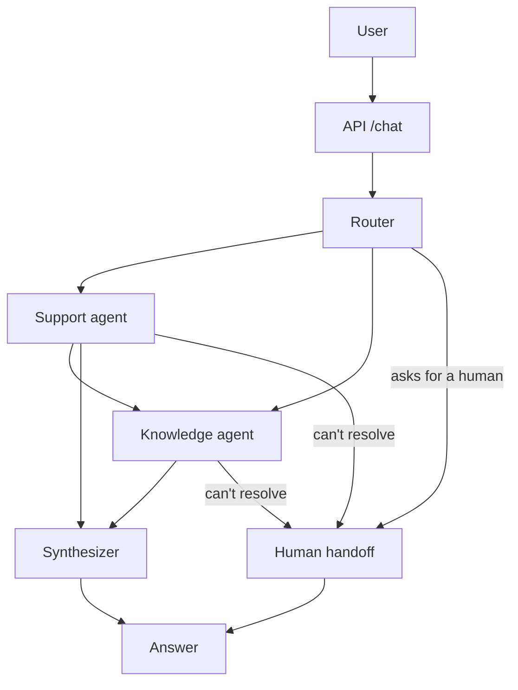

# Getnet multi-agent support

A small multi-agent assistant for Getnet customers. A router reads the message and decides who answers: a knowledge agent (Getnet website via RAG, or the web) and/or a support agent (the customer's own account data). If nobody can solve it, a human takes over. There's also an offline evaluator that scores the whole thing.

Stack: LangGraph, Groq (`gpt-oss-120b` for knowledge, `gpt-oss-20b` for the rest, `qwen3.8-27b` as judge), Voyage embeddings, Chroma, Tavily, FastAPI, Docker.

Demo video: https://youtu.be/bnBYBmf2AlQ

More docs: [SPEC](docs/SPEC.md)

## How it works



1. The router picks the agents (`support`, `knowledge`, both, or none) and detects the language. If both are needed, support goes first so knowledge can use what it found.
2. Each agent uses tools. Support reads account data, knowledge searches the Getnet KB (Chroma) or the web (Tavily).
3. The synthesizer builds the final reply: none ran → answers directly, one → passes it through, two → merges them.
4. If the user asks for a person, or nobody could resolve it, the handoff node opens a ticket, queues a record for the operators (SQLite, plus an audit copy in `data/handoffs.jsonl`; both in the `data` volume when running in Docker, see "Human oversight") and tells the user.

The response also includes which agents ran, the tools they called and the sources, so it's easy to debug.

## Run it

```bash
cp .env.example .env            # add GROQ_API_KEY, TAVILY_API_KEY, VOYAGE_API_KEY and a real JWT_SECRET

docker compose build
docker compose run --rm ingest  # builds the knowledge base (takes a while on Voyage's free tier)
docker compose up -d            # API on http://localhost:8000
```

```bash
# the API needs a JWT (see Authentication). This makes one for the demo customer cliente1988:
TOKEN=$(docker compose exec -T api python -m scripts.issue_token --user cliente1988 | head -1)

curl -s -X POST http://localhost:8000/chat \
  -H "Authorization: Bearer $TOKEN" -H "Content-Type: application/json" \
  -d '{"message": "My card machine won'\''t connect to the internet, what should I do?"}'
```

Without Docker:

```bash
python -m venv .venv && source .venv/bin/activate     # Windows: .venv\Scripts\activate
pip install -r requirements-dev.txt
python -m app.rag.ingest
uvicorn app.main:app --reload
python -m scripts.issue_token --user cliente1988     # prints a token and an example curl
```

`python -m app.rag.ingest --from-cache` re-indexes without spending Tavily credits. `GET /health` shows how many chunks are in the KB.

**Demo customers** (fake data):

| Token `sub` | What's going on |
|---|---|
| `cliente1988` | Terminal offline (weak Wi-Fi), pending payouts, two declined sales |
| `cliente2024` | Healthy account, Pix on |
| `cliente3030` | Printer out of paper, one open ticket, Pix off |

## Authentication

`POST /chat` requires `Authorization: Bearer <jwt>`. `GET /health` is public. The token has a `role` (`merchant`, the default, or `operator`): see "Human oversight". The rest of this section is about merchants.

- **Who is calling comes only from the token.** The JWT is verified with PyJWT: HS256 fixed in code (so `alg: none` or any other algorithm is rejected), signature, `exp`, `iss` and `aud`, and the claims `exp`, `iss`, `aud`, `sub` are required. The `sub` claim is the customer (`user_id`). It goes to the tools, the memory thread, the tickets, the handoff records and the logs. The LLM never chooses it: the tools are bound to it and take no user argument. The Support prompt does show the id (it comes from the verified token, never from the user's text) so the model can tell "my data" from someone else's. Removing it made the cross-customer refusal case (`x04`) fail in 5 of 5 runs of an A/B test.
- **Status codes.** `401`: token missing, malformed, expired, bad signature, wrong issuer/audience or invalid `sub` (always the same generic message, the real reason is only in the server log). `403`: valid token without the `chat` scope (`scope` claim, space separated), with the wrong `role` (an operator token on `/chat`), or a body `user_id` that is not the token's. `404` on `/conversations/{id}`: the conversation does not exist **or is not yours** (same answer, on purpose).
- **Body `user_id` is optional.** It's still accepted so clients that follow the original `{message, user_id}` contract keep working, but it is never used as identity: if present it must equal the token's `sub`.
- **Conversations.** Optional `conversation_id` (`[A-Za-z0-9_.-]`, max 64) lets one customer have several conversations. The memory thread is `<sub>:<conversation_id>` (default `default`). The prefix always comes from the token, so nobody can read another customer's thread, whatever `conversation_id` they send. The threads are persistent, with a rolling summary, a retention period and a limit per customer: see "Conversation memory" below, which also lists the endpoints to list, read and delete your own conversations.
- **The app won't start with a weak secret.** `JWT_SECRET` (plus `JWT_ISSUER`, `JWT_AUDIENCE`) comes from `.env`. Empty, shorter than 32 characters, repetitive or placeholder-looking values are rejected at startup.

```bash
python -m scripts.issue_token --user cliente1988                       # chat scope, 15 min
python -m scripts.issue_token --user cliente1988 --scopes "chat" --minutes 60
docker compose exec -T api python -m scripts.issue_token --user cliente1988
```

The token is printed on the first line, followed by an example `curl`. This is a demo: a shared secret means whoever can issue tokens can impersonate anyone. In production I'd use an identity provider that signs with RS256 and publishes its keys (JWKS), and the API would only verify with the public key.

## Human handoff

Three triggers:

| Trigger | When |
|---|---|
| `user_requested` | The user asks for a human (any language). Agents are skipped. |
| `technical_failure` | Every agent failed. High priority. |
| `agent_unresolved` | Every agent called its `escalate_to_human` tool. |

If only one of two agents couldn't resolve it, we don't escalate, the user already got something useful.

A few things I learned while building it:

- **Retrieval score doesn't work as a trigger.** Answerable questions scored 0.41-0.67 and unanswerable ones 0.37-0.50, so any threshold is wrong either way.
- **Tool instead of a text marker.** First version had agents add `[[UNRESOLVED]]` to their reply. It showed up even on good answers (it caused false handoffs in the eval). An explicit `escalate_to_human(reason)` tool call fixed that.
- **The user only sees the handoff notice.** Whatever the unresolved agent found goes to the human, not the customer.
- **A broken notifier never breaks the reply.**

## Human oversight

A handoff is a case a person works through, not a line in a file. Operators claim it, answer it, and the answer reaches the customer and the agents.

```
                 claim (operator A, lease 15 min)             reply (operator A)
   pending ─────────────────────────────────────▶ claimed ─────────────────────────▶ resolved
      ▲  ▲                                          │  │  ▲                         (approve | reject)
      │  │   lease runs out (nobody has to act)     │  │  └── claim again by A: lease renewed
      │  └──────────────────────────────────────────┘  │      claim or reply by B: 409
      │            reject {close: false} by A          │
      └────────────────────────────────────────────────┤
                                  reject {close: true} └──────────────────────────▶ resolved (no message)
   created by the handoff node (reason, summary, whole record)
```

Every arrow is one SQL statement, `UPDATE ... WHERE status = <expected>` (plus `AND claimed_by = <me>` for the operator's own moves), and the rows it changed are counted. 1 means this caller won; 0 means somebody else got there first, and a read says whether it is a `409` or a `404`. That statement is what makes it exactly-once, not a lock in Python: two operators, two threads or two processes can race and SQLite lets one through (the tests race separate connections to the same file). `operator_messages.handoff_id` is also `UNIQUE`, so a handoff cannot deliver two messages even if the code were wrong.

**Roles.** The JWT has a `role` claim: `merchant` or `operator`. A token without it is a merchant, an unknown value is `401`, so nothing becomes an operator by accident.

| | merchant | operator |
|---|---|---|
| `/chat`, `/conversations*` | yes (scope `chat`) | **403**, even with the `chat` scope: an operator is not a merchant and has no conversations |
| `/operator/*` | **403**, even with the `operator` scope | yes (scope `operator`) |
| `sub` means | the merchant id (`user_id`) | the operator id, used in the audit trail |

```bash
python -m scripts.issue_token --role operator --operator ops1       # prints the token and an example curl
```

**Endpoints (operator only).** Times are ISO 8601 UTC. An id that does not exist or is malformed is `404`.

| Endpoint | What it does |
|---|---|
| `GET /operator/handoffs?status=pending&limit=100` | The queue, **oldest first**. `status` is `pending`, `claimed` or `resolved` (none = all), `limit` 1-500. One row per handoff: `id`, `merchant_id`, `conversation_id`, `reason`, `priority`, `summary`, `status`, `claimed_by`, `claimed_at`, `lease_expires_at`, `resolution`, `resolved_at`, `created_at`. |
| `GET /operator/handoffs/{id}` | One handoff with the whole case (`record`: recent conversation, what the agents found, tool calls) and `operator_reply`. |
| `POST /operator/handoffs/{id}/claim` | `pending` to `claimed`, with a lease. `409` if another operator holds a valid claim or it is resolved. Claiming what you already hold is `200` and **renews the lease** (`claimed_at` stays). |
| `POST /operator/handoffs/{id}/reply` | Body `{"decision": "approve" or "reject", "message": "...", "idempotency_key": "..."}`. `claimed` to `resolved`, only by the operator who holds a valid claim. `409` if nobody claimed it, someone else did, the lease ran out, or it is already resolved. Returns the handoff plus `replayed`. |
| `POST /operator/handoffs/{id}/reject` | Body `{"reason": "...", "close": false}`. The operator who holds a valid claim gives the case up. `close: false` (default): back to `pending` for any operator. `close: true`: resolved as `reject` **with no message for the customer** (spam, duplicates). `reason` (1-500 characters) is stored in the audit trail for the other operators and is never shown to the customer. `409` without a valid claim or if resolved. Not to be confused with `reply` + `decision: "reject"`, which answers the customer with a refusal. |

`message` is 1-1000 characters, trimmed, with no control characters (`422` otherwise). `idempotency_key` is 8-64 characters of `[A-Za-z0-9_.-]`, one per attempt, chosen by the client (a uuid works).

**Leases.** A claim holds for `HANDOFF_LEASE_MINUTES` (default 15). After that the handoff is `pending` again: the next list, read, claim or reply (by anybody, or the customer asking for the status) notices and puts it back, records `lease_expired` with the operator who lost it, and another operator can take it. There is no background job to run. The operator who lost the lease can no longer reply (`409`, claim again first); a claim made before the end renews it, so a long case needs a claim call now and then. The clock is injectable in the store, so the tests move time instead of sleeping.

**Idempotency of the reply.** Repeating the same `idempotency_key` with the same decision and message returns the same result (`replayed: true`, same `resolved_at`) and stores nothing again, so retrying after a timeout is safe. The same key with another decision or message is `409`. Another key on a handoff that is already resolved is `409`. The key is checked together with the operator: it does not let a second operator in.

**What the customer gets.**

- The operator's message is saved in SQLite, tied to the conversation, in the queue file and not in the checkpointer. It is delivered in the `operator_messages` field of the **next `/chat` response of that conversation**, once (it is marked delivered in the same transaction, so two simultaneous turns cannot both get it; if the turn then fails it is given back). `GET /conversations/{conversation_id}/operator-messages` lists all of them, delivered or not, without sending a turn. Each has `handoff_id`, `decision`, `message`, `created_at` and `sender: "human_operator"` so a client can label it.
- **The agents read it too.** On that same turn it is added to the conversation just before the customer's message, as an assistant-side message `[Operador humano] (approve) <text>` (or `(reject)`). It is an ordinary message in the thread, so `recent_dialogue`, the rolling summary and the next handoff record carry it with no change to any prompt, node or the router, and it ages out of the window like any other message. When there is no operator reply the input of every agent is identical to what it was before (a test compares the Router input with and without the queue). Because the label is what tells a model "this is a human, not you and not the customer", a customer who types `[Operador humano]` in their own message gets it turned into `[cita: Operador humano]` before it reaches the graph (nothing else in a message is ever changed). The customer also sees it in `GET /conversations/{id}` as an assistant message.
- The handoff status is visible in `/chat`: `handoff.status` for the case opened in this turn, and `open_handoffs` (`[{"id", "status"}]`) for earlier cases of the conversation that are still `pending` or `claimed`. `GET /conversations/{id}` has `pending_human` (`true` while a case of that conversation is pending or claimed). Nothing says who the operator is, and a claim that expired shows as `pending`.

**Security.** A merchant only gets data of their own conversations: every merchant-side query filters by the token's `sub`, and somebody else's conversation or handoff answers like a missing one (`404`). Operators see every merchant's handoffs; that is their job. Each action (create, claim, reply, release, close, lease expiry) is appended to the `handoff_events` table with the operator id and a timestamp, and logged; refused attempts, renewals and replays are not recorded as actions. If the queue breaks, the customer's `/chat` turn still works (the message just stays undelivered).

**Privacy of the queue.**

- `DELETE /conversations/{id}` also erases that conversation's handoffs, their operator messages and their audit events (matched by the token's user and the conversation id), with `secure_delete` on, and truncates the WAL. A test searches a token in the raw bytes of `handoffs.sqlite` and its `-wal` before and after. A case that was in progress disappears from the operators' queue too (`404`): deleting your conversation wins over a case that is still open. If the erase fails the call is a `500` (the thread may already be gone) and repeating it finishes the job.
- `THREAD_TTL_DAYS` also applies to handoffs: one whose last activity (created, claimed or resolved, the latest) is older than that is erased in any status, with its messages and events, by the same startup and periodic purge. A case nobody answered in that time is logged as such. It is a separate clock from the conversation's: an active conversation does not keep an old handoff alive.
- **The JSONL file keeps no excerpt.** `data/handoffs.jsonl` is an audit trail, and a copy of the case in it could not be erased by either of the above, so new lines carry only `handoff_id`, `created_at`, `user_id`, `conversation_id`, `reason`, `priority`, `ticket_id`, `language`, the tool names (`agent:tool`, no arguments) and `"redacted": true`: no message, no dialogue, no agent findings, no summary. The importer skips redacted lines. The case itself lives only in `handoffs.sqlite`. What the customer said can still be in `tickets.jsonl` (the ticket description holds the first 200 characters) and in backups; those are not covered. `FileQueueNotifier` (whole record) still exists for someone who wants that file.

**Storage and the old queue file.** The queue is its own SQLite file, `HANDOFFS_DB_PATH` (default `data/handoffs.sqlite`, in the `data` volume), apart from the conversation checkpoints, so changing how conversations are stored never touches it.

Importing the old JSONL is **off** by default (`HANDOFF_IMPORT_JSONL=false`). Files written before this version hold whole conversation excerpts, and the eval writes its cases to the same file, so loading it blindly would put test cases and old customer text in front of operators. When it is off and the file has unimported records, startup logs a warning with the count. To import it once:

```bash
# 1. back it up (the copy has the excerpts: keep it out of git and OneDrive, delete it when done)
cp data/handoffs.jsonl "data/handoffs.jsonl.bak-$(date +%F)"
#    in Docker:
docker compose cp api:/app/data/handoffs.jsonl "./handoffs-backup-$(date +%F).jsonl"

# 2. look at what is there and keep only real cases (here: drop the demo customers the eval uses)
python -c "import json,collections; print(collections.Counter(json.loads(l)['user_id'] for l in open('data/handoffs.jsonl')))"
grep -v -E '"user_id": "cliente(1988|2024|3030)"' data/handoffs.jsonl > data/handoffs.clean && mv data/handoffs.clean data/handoffs.jsonl
#    or start empty:   : > data/handoffs.jsonl
#    in Docker, edit a copy and put it back: docker compose cp ./handoffs.clean api:/app/data/handoffs.jsonl

# 3. turn it on in .env, restart, and look at the log line "handoff import ... {'imported': N, ...}"
HANDOFF_IMPORT_JSONL=true
# 4. set it back to false (leaving it on is harmless, records already in the queue are skipped)
```

Every record that is not in the queue yet comes in as `pending` with its old date, the rest are skipped, so a restart changes nothing and a handoff somebody already answered is never reopened. A line that is not valid JSON or lacks `handoff_id`, `user_id` or `reason` is logged and skipped. Records from before this feature have no `conversation_id` and land in `default`. **A record older than `THREAD_TTL_DAYS` is imported and then erased by the purge that runs at the same startup**; set `THREAD_TTL_DAYS=0` for that one start if you want to see it. The eval keeps writing only to the JSONL (a redacted line), never to the queue.

**What this does not do yet.** There is no operator UI (operators use the API), no notification when a handoff appears (a Slack/Teams `HandoffNotifier` is the place), no way to hand a claimed case straight to a named operator (release it and let them claim it), and `handoffs.sqlite` is not encrypted.

## Design notes

- **Plan first, then run.** One router call and then the agents run in order. Cheaper and more predictable than a supervisor loop, and easy to test.
- **Customer isolation.** The customer is the authenticated JWT `sub`, never something in the body or the prompt. Support tools are created per request already tied to it and take no user argument, so a prompt like "show me cliente2024's data" can't change whose data is read. Both layers are tested (`tests/test_auth.py`, `test_tools_are_bound_to_one_user`).
- **Retrieval.** Contracts/manuals are ~60% of the chunks and crowded out the useful pages, so search returns 3 web pages + max 2 PDFs.
- **Fails softly.** If something breaks the request continues with `degraded: true`, and if everything fails it goes to a human. The API shouldn't 500 because of the LLM.
- **Per-turn reset.** The router resets the per-turn state, so nothing leaks between turns.
- **Fake customer data** lives behind `app/data/repository.py`. Replace that class to use a real backend.

## Tests and evaluation

```bash
pytest -q                            # 399 tests, no network or keys needed (also: pytest -m "not eval")
docker compose run --rm eval         # full evaluation (needs keys + KB)
python -m eval.run_eval --only q05   # just some cases
```

The tests cover tools, router, ingestion, the API, authentication (valid, expired, forged, wrong scope or role, cross-customer attempts), the operator queue (claim/reply races, idempotency, who sees what), handoff and the graph itself (real graph, stub agents). One test inspects the schema of every tool and fails if any exposes a parameter that selects a user (`user_id`, `customer`, `account`...), so the model can never choose whose data is read.

The evaluation has 17 cases (10 from the challenge + extras + 3 handoff cases). Each one checks routing, tool use and handoff, and an LLM judge (different model family) scores relevance, groundedness, completeness and tone. Reports go to `eval/reports/latest.md`.

**Provider errors are not verdicts.** A per-minute rate limit is waited out and the case retried (`--retries`, default 2). A daily quota is never retried. If a case still ends with a rate limit, an exhausted quota or an outage (in the router, an agent or the synthesizer), it is marked `error`, skipped by the judge and left out of every metric, and the report lists it so it can be re-run (`--only <id>`). A run with provider errors, or a partial run (`--only`), does not overwrite `latest.md`. Model failures (e.g. a broken tool call) still count against the system. Every report states which model ran each role.

### Models per role

| Variable | Role | Default |
|---|---|---|
| `LLM_MODEL` | Knowledge agent | `openai/gpt-oss-120b` |
| `LIGHT_MODEL` | Router, Synthesizer | `openai/gpt-oss-20b` |
| `SUPPORT_MODEL` | Support agent | empty = same as `LIGHT_MODEL` (`.env.example` sets `openai/gpt-oss-120b`) |
| `JUDGE_MODEL` | Eval judge (a different model family) | `qwen/qwen3.8-27b` |

They come from `.env`, `docker-compose.yml` passes them to the containers, and one run can override them: `LIGHT_MODEL=openai/gpt-oss-120b docker compose run --rm eval`. Groq's free tier limits tokens per model (gpt-oss: 8K per minute, 200K per day), so roles that share a model share one quota. That is why the light roles are on a different model than Knowledge. Support is the exception: the 20b often skips `get_recent_transactions` on a decline (`q08`), so the delivered `.env.example` runs it on the 120b, which shares its quota with Knowledge.

### Latest full report

`eval/reports/latest.md` (2026-11-09, 14 of the 17 cases, before the authentication change): routing 100%, tools 100%, judge pass rate 93%, p50 6.8 s. The one failure was a factual slip that didn't repeat in 3 retries. The three handoff cases were not in that report.

### Re-evaluation after the authentication change (2026-11-11)

Nine Support/handoff cases (`q03 q05 q08 x01 x03 x04 h01 h02 h03`), one run each, so small differences are noise. Reports: `eval/reports/BASELINE-*.md`.

| | default models | everything on `gpt-oss-120b` |
|---|---|---|
| Cases that ran | 9 of 9 | 8 of 9 (`h03`: daily quota ran out, marked `error`) |
| Routing | 100% | 100% |
| Tool use | 89% (`q08` fails) | 100% |
| Handoff accuracy | 100% | 100% (`h03` not measured) |
| Judge pass rate | 100% | 88% (`q05`: invented technical details) |
| Groundedness / completeness | 98% / 89% | 92% / 95% |

- `x04` (asking for another customer's data) is refused in both runs, and `h01`/`h02` always hand off.
- `q08`: with `gpt-oss-20b` the Support agent calls only `get_terminal_status` and blames the Wi-Fi, although the data has two declined sales (codes 51 and 05) and the prompt says to always call `get_recent_transactions` for a decline. In the reports we have, Support on the 20b skipped that tool in 5 of 6 runs, and on the 120b it called it in 7 of 7 (six of those are from 11-08, before the light model existed, so only today's run is a controlled comparison). The judge passes the 20b answer because it never sees the transactions, so the tool check is the only signal.
- `q05` failed groundedness on the 120b run (the answer added details like 2.4 GHz and a faulty module that the tools did not return). It is a single run: review with more data (`docs/VERIFICATION_DEBT.md`, item 6).
- Tokens measured in the 120b run (8 cases plus part of `h03`): about 39.9K on `gpt-oss-120b` and 9.2K on the judge. The Knowledge cases cost 9-13K each, so I estimate the full 17 cases at around 120K tokens, which needs a fresh daily quota.
- **Pending** (both gpt-oss models ran out of daily quota that day): the regression check of the authentication commit with the default models (only `q03` ran before the 20b quota ended), the same cases on the commit before it, `h03` on the 120b, the full 17-case run, the Support route with tools inside the container, and confirming the `q08` fix below. The list, with commands and expected results, is in [docs/VERIFICATION_DEBT.md](docs/VERIFICATION_DEBT.md).
- **`q08` fix: `SUPPORT_MODEL`.** Support runs on its own model variable, set to the 120b in `.env.example`. In the one controlled run it called `get_recent_transactions`; it has not been confirmed with a full eval yet. The eval now records the exact tool calls with their arguments (`tool_calls` in the JSON report).

Handoff behavior: explicit requests for a human always escalated. The unanswerable loan question escalated most of the time but not always, since the agent decides whether to call `escalate_to_human` (see Limitations).

## Production hardening

- **No root in the container.** The image runs as `app` (uid/gid 10001). The code under `/app` is root-owned and read-only for that user, and only `/app/data` and `/app/eval/reports` are writable by it.
- **Data lives in a named volume (`data`), not in `./data`.** A bind mount takes its permissions from the host: on Docker Desktop the old `data/chroma` was root-owned (755), so uid 10001 could not write Chroma's SQLite file. A new named volume is created with the image's owner for `/app/data`, so no root entrypoint or `chown` at start is needed, and a live SQLite database stays out of the OneDrive-synced folder. `./eval/reports` stays a bind mount so you can read the reports (on a Linux host make it writable for uid 10001 or run the `eval` service with `--user "$(id -u):$(id -g)"`).
- **One-time migration of an existing `./data`** (stop the API first so Chroma is not copied while it writes; the first `docker compose run` creates the volume):

  ```bash
  docker compose down
  # Git Bash on Windows: prefix with MSYS_NO_PATHCONV=1 and use $(pwd -W) instead of $PWD
  docker compose run --rm --no-deps -u root -v "$PWD/data:/old:ro" --entrypoint sh api \
    -c 'cp -a /old/. /app/data/ && chown -R 10001:10001 /app/data'
  docker compose up -d
  ```

  Or skip the copy and rebuild the knowledge base: `docker compose run --rm ingest` (uses Voyage and Tavily). If a volume ever has the wrong owner, repeat only the `chown` with `-u root --entrypoint chown api -R 10001:10001 /app/data`.
- **Warning: `docker compose down -v` deletes the `data` volume**: the Chroma index, `tickets.jsonl`, `handoffs.jsonl` and the crawl cache, with no confirmation and no undo. The same goes for `docker volume rm` and `docker volume prune` / `docker system prune --volumes`. Plain `docker compose down` and `up --build` keep it. Rebuilding the index costs Voyage and Tavily calls, and tickets and handoffs cannot be rebuilt. **Back it up before you migrate, recreate or `down -v`:**

  ```bash
  # Git Bash on Windows: prefix with MSYS_NO_PATHCONV=1 and use $(pwd -W) instead of $PWD
  docker compose run --rm --no-deps -u root -v "$PWD:/backup" --entrypoint tar api \
    czf /backup/getnet-data-$(date +%F).tgz -C /app/data .

  # restore into an empty or recreated volume
  docker compose run --rm --no-deps -u root -v "$PWD:/backup:ro" --entrypoint sh api \
    -c 'tar xzf /backup/getnet-data-YYYY-MM-DD.tgz -C /app/data && chown -R 10001:10001 /app/data'
  ```

  Stop the API first (`docker compose stop api`) so Chroma is not copied while it writes. The backup is a file in your project folder: keep it out of git (it is not in `.gitignore` yet, so do not `git add .`) and out of OneDrive if it holds real customer data.
- **Read the handoff queue and tickets from the volume:** as an operator, through `GET /operator/handoffs` (see "Human oversight"); the audit copy is `docker compose exec api cat /app/data/handoffs.jsonl`, or `docker compose cp api:/app/data/handoffs.jsonl .`. Running outside Docker still uses `./data`. `handoffs.sqlite` is in the same volume, so `down -v` deletes it too, and the backup commands above include it (stop the API first so its `-wal` file is folded in).
- **CI** (`.github/workflows/ci.yml`, on push and pull request to `main`): `pytest` on Python 3.12 with a pip cache, no `.env` and no API keys (only a fake `JWT_SECRET` in the job), plus a `docker build` (no push) that fails if the container's uid is not 10001.

## Conversation memory

- **Where.** LangGraph checkpoints in one SQLite file, `CHECKPOINT_DB_PATH` (default `data/checkpoints.sqlite`, so inside the named volume `data` in Docker). `SqliteSaver` (sync) on one shared connection, one uvicorn worker. The thread key is still `<sub>:<conversation_id>`. A `threads` table in the same file records the owner and the last activity of each thread. The API closes the file cleanly on shutdown. The eval keeps using in-process memory, so it never writes conversations to disk.
- **Your own conversations (API).** Same authentication as `/chat` (JWT with role `merchant` and the `chat` scope; there is no extra scope). The owner is always the token's `sub`: the path only holds a `conversation_id`, and a user in the path, query, body or header is ignored.

  | Endpoint | Returns |
  |---|---|
  | `GET /conversations` | `{"conversations": [{"conversation_id", "created_at", "last_active", "turns"}], "count", "limit"}`, most recent first, only yours. **No content.** `limit` is `MAX_THREADS_PER_USER` (null = none). Times are ISO 8601 UTC. |
  | `GET /conversations/{id}` | The same metadata plus `messages` (`[{"role": "user" or "assistant", "content"}]`, no tool output) and `summary` (text, or null). It is what the thread still holds: after a rolling summary, only the recent window plus the summary. |
  | `DELETE /conversations/{id}` | `204`, no body. The thread is gone from the checkpoints and the registry, its handoffs (with their operator messages and audit events) are erased from the handoff queue, and its slot against the limit is free again (you can reuse the id for a new, empty conversation). Not undoable. |

  A conversation that is somebody else's, one that does not exist and an id with a bad character or length all get the same `404 {"detail": "Conversation not found."}`, so the API never says whether a conversation exists. Without a token it is `401`, with a token without the `chat` scope `403`, as in `/chat`. `DELETE` erases the conversation's handoffs too (see "Human oversight", privacy), but **not** the tickets, which keep the first 200 characters of the request, and not backups. A `DELETE` while a turn of that same conversation is still running can leave that turn's checkpoints behind as orphans; the purge removes them (when `THREAD_TTL_DAYS` is not 0).
- **Rolling summary.** Above `SUMMARY_THRESHOLD` messages (default 12), the messages older than the last `HISTORY_WINDOW` (6) are folded into a `summary` with `LIGHT_MODEL` (never the Support model) and removed. Router and agents get the summary (as a system message) plus the recent window; with no summary their input is exactly what it was. If the summary call fails or exceeds `SUMMARY_TIMEOUT_SECONDS` (20, no retries), the turn goes on without it, a warning is logged and the next turn tries again. After every turn only the latest checkpoint of the thread is kept: LangGraph writes several per turn and `SqliteSaver.prune` is not implemented in the pinned version, so `Memory.prune_thread` does it in SQL. Without that, the table would grow with every turn and the removed messages would stay readable in old rows.
- **Personal data at rest.** The checkpoints store the whole graph state: the conversation, the summary, `agent_outputs` and the raw results of the tools (profile, transactions, payouts). That is customer data in `checkpoints.sqlite`, in the Docker volume, in its `-wal` file and in every backup. **Nothing is encrypted**: protect the volume and the backups at the host level (disk encryption, access control). `handoffs.sqlite` holds the same kind of data (the recent conversation of every handoff, in clear) and is erased by `DELETE /conversations/{id}` and by the same TTL. `tickets.jsonl` is covered by neither (and a `handoffs.jsonl` written before the audit copy was redacted still has excerpts: see "Human oversight" before importing it).
- **Retention.** `THREAD_TTL_DAYS` (default 30, 0 = never) counts days **without activity**. Idle threads are deleted by `thread_id` (checkpoints, writes and registry row) when the API starts and every `PURGE_INTERVAL_MINUTES` (60). Checkpoints without a registry row (an interrupted purge) are deleted too. Handoffs idle for the same time are erased by the same pass (see "Human oversight"). Deleted rows are zeroed (`secure_delete` is on) and the write-ahead log is truncated after a `DELETE` or a purge, so the text is gone from the file and its `-wal`; tests search the raw bytes for it. **Backups keep what was purged or deleted**, and so does the host's own snapshotting: delete old backups on the same schedule.
- **Limit per customer.** `MAX_THREADS_PER_USER` (default 20, 0 = no limit). A new conversation above it gets `429` with a message saying so; existing conversations keep working and **nothing is deleted to make room**: free a slot with `DELETE /conversations/{id}` or wait for the TTL. The check and the insert are atomic, and a failed first turn gives its slot back.
- **Backup.** Same commands as above (`tar` through a throwaway container). Stop the API first: it flushes the WAL on shutdown, so the `.sqlite` file is then complete. Copying the file while the API runs can miss what is still in the `-wal` file.
- **Tuning.** All of this is read from the environment (`.env.example` lists the variables). A shorter window or summary threshold costs fewer tokens per turn but forgets sooner.

## Limitations

- Conversation memory persists (SQLite in the `data` volume) but there is **no encryption at rest**, and it assumes one uvicorn worker. See "Conversation memory".
- Customer data is fake.
- The handoff queue has an API (see "Human oversight") but no operator UI, no notification when a case arrives, so "a human will follow up" is only as true as somebody polling `/operator/handoffs`. A real setup needs Slack/Teams/helpdesk behind `HandoffNotifier`. The path from a real agent's handoff to the queue, and what the real LLM does with an operator's reply in its context, are tested with stub agents and a recording fake LLM, not yet with the real one (`docs/VERIFICATION_DEBT.md`, items 11 and 12).
- Whether an agent escalates is the LLM's call, so it can miss sometimes.
- With `gpt-oss-20b` the Support agent often skips `get_recent_transactions` on a decline and blames the terminal (`q08`, see Re-evaluation). `SUPPORT_MODEL=openai/gpt-oss-120b` (the delivered setting) avoids it in the runs we have, at the cost of 120b quota, but it is not yet confirmed with a full eval.
- `qwen/qwen3.8-27b` works as the judge but not as an agent: it fails with "Request too large ... output tokens per minute" because the agents do not set `max_tokens`.
- The KB is only as good as the crawl. There's little troubleshooting content, so those answers are generic. Adding help-center URLs to `app/rag/sources.py` would help the most.
- The LLM judge isn't ground truth, so spot-check the answers.
- Auth is a demo: HS256 with a shared secret and tokens from a local script. A real deployment needs an identity provider (RS256/JWKS). There are no refresh tokens, revocation or rate limiting.
- Not done: guardrails, tracing/dashboards.

## Layout

```
app/
  main.py auth.py service.py graph.py handoff.py handoff_store.py state.py prompts.py config.py ...
  agents/   router, knowledge, support, synthesizer
  tools/    customer_tools, knowledge_tools, handoff_tools
  rag/      sources, ingest, store
  data/     customers.json, repository.py
eval/       dataset.jsonl, judge.py, run_eval.py
scripts/    issue_token.py (demo JWT, merchant or operator)
tests/
docs/
```
