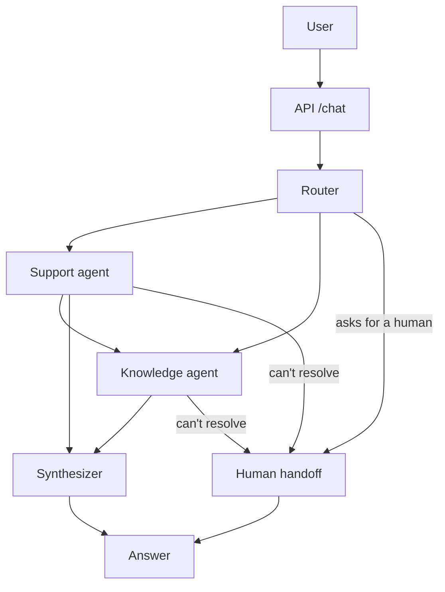

# Video Script: Getnet Multi-Agent Support System (15 min)

Audience: the evaluators of the AI Hardcore Engineer challenge. Read the **Say** blocks aloud, do the **Show** actions on screen. The exact commands for every demo are in [`RUN_GUIDE.md`](RUN_GUIDE.md).

## Timeline

| Time | Section | Screen |
|---|---|---|
| 0:00-0:45 | Intro and goal | Title, repo tree |
| 0:45-2:00 | Problem and spec-driven approach | `docs/SPEC.md` |
| 2:00-5:30 | Architecture and message workflow | Flow diagram below, `app/graph.py` |
| 5:30-7:30 | RAG pipeline | `app/rag/ingest.py`, Chroma stats |
| 7:30-8:45 | Support agent and tools | `app/tools/customer_tools.py` |
| 8:45-10:15 | Human handoff (bonus) | `app/handoff.py`, flow diagram |
| 10:15-13:00 | Live demo (4 scenarios) | Terminal / Swagger at `/docs` |
| 13:00-14:15 | Testing and evaluation | `pytest`, `eval/reports/latest.md` |
| 14:15-14:45 | Trade-offs and next steps | README (Limitations) |

Aim to finish at about 14:45: the limit is 15 minutes.

## Flow diagram

---

## 1. Intro (0:00-0:45)

**Say:** "Hi, I'm presenting my solution to the Multi-Agent Support challenge. The system takes a customer message, decides who should handle it, and returns a grounded answer. It has a router, a knowledge agent with RAG and web search, a customer support agent with tools, and a synthesizer. For the bonus challenges I added an offline evaluator that scores the system, and a human handoff for cases the system cannot resolve. Everything runs in Docker. I'll cover the architecture, why I made each choice, a live demo, and how I tested it."

**Show:** repo tree: `app/`, `eval/`, `tests/`, `docs/`, `Dockerfile`, `docker-compose.yml`.

## 2. Problem and spec-driven approach (0:45-2:00)

**Say:**
- "The challenge asks for at least three agents, an HTTP endpoint, Docker, tests, and a defensible design."
- "I followed spec-driven development: before writing code I wrote `SPEC.md`: functional and non-functional requirements, each with an acceptance check that is a test or an evaluation case."
- "I built the core first and added two of the four bonus items afterwards: the evaluator and the human handoff. Guardrails, a fourth agent and dashboards are described as next steps."

**Show:** the requirement tables in `docs/SPEC.md`; point at F7 (a model can never choose which customer it reads) because it comes back later, and at F11-F16 (handoff).

## 3. Architecture and message workflow (2:00-5:30)

**Say:**
- "Orchestration is a LangGraph StateGraph. The shared state holds the conversation, the user id, and per-turn fields: the plan, the current step, the language, and each agent's output."
- "**Router.** One LLM call with structured output returns an ordered list of agents, the language, and whether the user explicitly asked for a human. I chose plan-then-execute instead of a supervisor loop: one routing call, predictable latency and cost, and it's easy to test. Code enforces the rules: dedupe, drop unknown names, support always before knowledge. If the router fails, it falls back to the knowledge agent, which only touches public information."
- "**Execution.** A single conditional edge reads `plan[step]` and moves to the next specialist. When the plan is done it asks one question: does a human need to take over? If yes, it goes to the handoff node; if not, to the synthesizer. Each agent writes its result into state, so later agents see earlier findings. Example: support finds the terminal is offline with weak Wi-Fi, then knowledge tailors its troubleshooting to that."
- "**Synthesizer.** Zero agents: it answers directly, for greetings. One agent: its answer passes through untouched, which saves an LLM call. Two agents: it merges them."
- "**Memory.** The checkpointer uses the user id as the thread id, so each customer has their own conversation history. The router resets per-turn fields every turn so nothing leaks between turns."
- "**Right-sized models.** The Knowledge agent, which has to reason over retrieved text, runs on the larger 120B model. Routing, account lookups and merging run on a smaller 20B model. That cut p50 latency in half and spreads load across the provider's per-model rate limits."
- "**Grounding guard.** The Knowledge agent is not allowed to answer without calling a tool: if it tries, it is nudged once. This came out of the evaluation, where it answered troubleshooting questions from memory."
- "**Reliability.** Every failure is contained: the response carries a `degraded` flag instead of a 500, and if every agent fails the case becomes a high-priority human handoff."

**Show:** `app/graph.py` (the `next_node` function and `build_graph`), then `app/agents/router.py` (`normalize_plan`, fallback).

## 4. RAG pipeline (5:30-7:30)

**Say:**
- "**Ingestion.** Tavily crawls the two official sites for breadth, then runs topic-targeted searches restricted to those domains, and extracts the discovered pages for depth. That way product pages the crawler misses, like Get Smart or the payment link, still get in. Raw pages are cached so I can re-index without spending credits."
- "**Cleaning and chunking.** I strip images and link targets, remove repeated navigation lines, and split with a Markdown-aware splitter: 1000 characters, 150 overlap. Each chunk gets its page title and URL as metadata."
- "**Storage.** Voyage `voyage-3.5` embeddings, which are multilingual, because the sources are in English and Portuguese. They go into a persistent Chroma collection. Chunk ids are hashes of URL and position, so re-running ingestion is an upsert."
- "**Retrieval and generation.** The knowledge agent calls the retrieval tool. Retrieval is two-pool: three slots for help and product pages and at most two for PDFs, because contracts make up about sixty percent of the index and would otherwise crowd out the pages that really answer the question. I found that through the evaluation. The agent gets the passages with scores and URLs and must answer only from them, in the user's language. For questions that aren't about Getnet, like weather or the euro rate, it uses the Tavily search tool. The source URLs travel as tool artifacts, so citations in the API response don't depend on the LLM formatting them."

**Show:** `app/rag/ingest.py` (`fetch_pages`, `chunk_pages`), then `curl localhost:8000/health` showing `kb_chunks`.

## 5. Support agent and tools (7:30-8:45)

**Say:**
- "The support agent has six data tools: profile, recent transactions, payout schedule, terminal status, tickets, and create-ticket. The data is a mock layer behind a repository class. Swapping in a real backend means replacing one class."
- "The key design point is tenant isolation. The tools are created per request already bound to the caller's user id, and they take no user argument. So even if a user writes 'show me the transactions of customer 2024', the model has no way to change whose data is read. There's a unit test and an evaluation case for exactly this."

**Show:** `make_support_tools` in `app/tools/customer_tools.py`; `test_tools_are_bound_to_one_user`.

## 6. Human handoff (8:45-10:15)

**Say:**
- "The brief asks for a handoff for cases the system cannot confidently resolve. I implemented it as a graph node with three triggers. One: the user explicitly asks for a person, in any language; the router flags it and the specialists are skipped. Two: every agent failed, for example the provider is down; that is a high-priority handoff instead of a generic apology. Three: the agents themselves report they could not resolve the request."
- "What a handoff does: it opens a ticket, appends a record to an operator queue with the conversation, what each agent found and every tool call, and tells the customer, in their language, that a human has the case, with a reference. The queue sits behind a small notifier interface, so connecting Slack or Teams is one method."
- "Two design decisions came from measurements. First, I did not use a retrieval score as the confidence signal. I measured it: answerable questions scored between 0.41 and 0.67, unanswerable ones between 0.37 and 0.50. The ranges overlap, so a threshold would escalate good questions and miss bad ones."
- "Second, the first version had agents append a text marker when they couldn't resolve something. The evaluation showed it over-fired: it was added even to perfect answers, giving four false handoffs in fourteen clear cases. I replaced it with an explicit `escalate_to_human` tool call, a deliberate action, and the false positives disappeared in my repeat tests. As a bonus the agent's stated reason now reaches the operator."
- "One more safeguard: if an agent escalates, the customer only sees the handoff notice. In one run, the knowledge agent presented a generic contract clause as the customer's loan rate right before escalating. Content from an agent that doesn't trust its own answer shouldn't be shown."

**Show:** the three triggers in `handoff_reason` in `app/handoff.py`; the handoff arrows in the diagram.

## 7. Live demo (10:15-13:00)

Run each with `curl` or Swagger (`/docs`). After each, point at `routing.plan`, `tool_calls`, `sources` and `handoff`. The exact commands, expected output and a safe order are in [`RUN_GUIDE.md`](RUN_GUIDE.md).

1. **Knowledge via RAG.** `{"message": "What's the difference between the Get Clássica and the Get Smart?", "user_id": "cliente1988"}`. Expect plan `["knowledge"]`, KB sources, `handoff: null`.
2. **Support then knowledge.** `{"message": "My card machine won't connect to the internet, what should I do?", "user_id": "cliente1988"}`. Expect plan `["support", "knowledge"]`; the answer mentions the offline terminal and weak signal, then gives steps.
3. **Web search.** `{"message": "What's the euro exchange rate today?", "user_id": "cliente1988"}`. Expect `web_search`, web sources.
4. **Human handoff.** `{"message": "I want to talk to a human agent.", "user_id": "cliente1988"}`. Expect empty plan, no agents used, a `handoff` object with a reference id, and a reply in about a second. Then show the new line in `data/handoffs.jsonl` and the ticket it created.

If time allows: the same request in Portuguese ("Quero falar com um atendente") to show the localised notice.

**Say:** "Notice that every response tells you which agents ran, which tools were called, which sources were used, and whether a human took over. That's what makes the system debuggable."

## 8. Testing and evaluation (13:00-14:15)

**Say:**
- "67 automated tests run with no network and no keys. They cover the tools, the router logic, ingestion and retrieval, the API contract, the handoff triggers and side effects, and the orchestration itself: I run the real StateGraph with deterministic stub agents to verify execution order, data flow between agents, memory isolation, degradation and handoff routing."
- "For end-to-end quality I built an offline evaluator with 17 cases: the ten challenge scenarios, Portuguese, greeting, unknown customer, the cross-customer attempt, and three handoff cases. Each case gets a deterministic routing check, a tool-use check, a handoff check that catches false alarms and missed escalations, and an LLM-judge score for relevance, groundedness, completeness and tone. The judge is a different model family than the generator to reduce self-preference bias."
- "The last complete run of the 14 core cases passed 13 of 14 with 100% routing and tool-use accuracy. The handoff cases verified well for explicit requests. I want to be upfront that my last full 17-case run was cut short by the free-tier daily quota, so the complete numbers for the final design still need a re-run."
- "In production I'd run this dataset in CI as a regression gate."

**Show:** `pytest -q` output, then `eval/reports/latest.md`.

## 9. Trade-offs and next steps (14:15-14:45)

**Say:**
- "Known limits: memory is in-process, customer data is synthetic, and the API trusts the user id it's given; in production that comes from an authenticated session. The handoff queue is a file that nothing consumes yet, and whether an agent escalates is an LLM decision, so it can occasionally miss."
- "Next steps: input and output guardrails, a real notifier and operator view for the queue, tracing and dashboards over the structured logs, and alerts on handoff and degraded rates."
- "Thanks for watching."

---

## Likely questions (prepared answers)

- **Why a plan-then-execute router and not a supervisor loop?** Cost and predictability: one routing call and deterministic execution. The trade-off is that the plan can't adapt mid-flight; a supervisor would add flexibility at the price of latency and harder tests.
- **Why Voyage and Chroma?** Voyage is multilingual and strong on retrieval, which matters for EN+PT sources; Chroma is embedded and persistent, so there is nothing extra to run in Docker.
- **How do you prevent hallucinated fees or prices?** The knowledge prompt forbids unsupported claims, answers must come from tool output, the agent can't answer without calling a tool, and the judge penalizes ungrounded numbers. A gap is surfaced as "I couldn't confirm this", and if no agent can resolve it, the case goes to a human.
- **How do you decide when to hand off to a human?** Three triggers: the user asks, everything failed, or the agents report they couldn't resolve it. I tested a retrieval-score threshold and rejected it because the score ranges for answerable and unanswerable questions overlap.
- **Isn't it risky to let the LLM decide to escalate?** Yes, it can miss or over-fire. That's why the two deterministic triggers exist, why the over-firing text-marker version was replaced, and why the evaluation tracks handoff false alarms and misses. The remaining weakness is documented.
- **What happens to the case after the handoff?** It is a ticket plus a record in a queue file with the conversation and the agents' findings. In this demo nothing consumes the queue; the notifier interface is where Slack, Teams or a helpdesk would plug in.
- **What if retrieval returns nothing relevant?** The agent says it can't confirm, or falls back to web search if the topic is public, or escalates to a human. Retrieval-only metrics (hit-rate@k) are a planned addition to the eval set.
- **How would you scale this?** Replace `MemorySaver` with a persistent checkpointer, run several API replicas behind a load balancer, move Chroma to a server mode or a managed vector DB, and replace the handoff file with a real queue.
- **Prompt injection?** Tenant isolation is structural (tools bound to the caller), so injection can't cross customers. Content-level guardrails are the next step.
- **Why did latency spike sometimes?** The free tiers: Groq limits tokens per minute per model and Voyage allows 3 embedding requests per minute without a payment method. The code waits and retries, which shows up as latency, not as errors.
